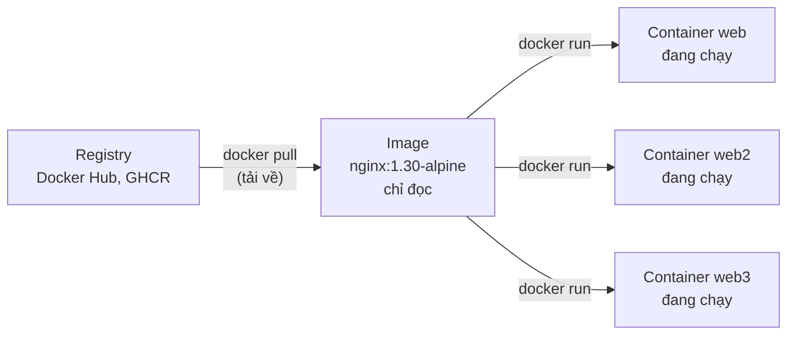
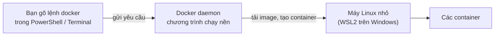

# Docker để làm gì? Image, container và máy ảo

Bài này chưa gõ lệnh nào (trừ một lệnh kiểm tra cài đặt). Mục tiêu là hiểu **bản chất**: những bài sau sẽ dễ hơn rất nhiều nếu bạn nắm chắc ba chữ image, container, registry.

## 1. Vấn đề: "Máy mình chạy được mà!"

Nhóm bạn làm đồ án web. An viết backend bằng Node 22 trên Windows, dùng Postgres 18. Bình clone về, máy Bình có Node 18 và Postgres 14. Chạy lên thì lỗi. An nói câu quen thuộc: *"Máy mình chạy được mà!"*.

Ứng dụng không chỉ là code. Nó còn cần **môi trường**: đúng phiên bản ngôn ngữ, đúng thư viện, đúng database, đúng biến cấu hình. Cài tay từng thứ trên từng máy thì máy nào cũng hơi khác một chút, và một chút khác đó đủ làm hỏng.

**Docker** (nghĩa đen: *công nhân bốc xếp ở bến cảng*) giải quyết bằng cách đóng gói **code cùng toàn bộ môi trường** thành một khối, rồi chạy khối đó giống hệt nhau trên mọi máy: máy An, máy Bình, máy chủ của công ty.

Hình ảnh dễ nhớ là **thùng container chở hàng**. Trước khi có thùng tiêu chuẩn, mỗi kiện hàng một kiểu, bốc xếp rất khổ. Có thùng tiêu chuẩn thì tàu, cần cẩu, xe tải nào cũng chở được, không cần biết bên trong là gì. Docker làm điều tương tự cho phần mềm.

## 2. Ba khái niệm: image, container, registry

| Khái niệm | Nghĩa đen | Là gì | Ví dụ đời thường | Ví dụ lập trình |
| --- | --- | --- | --- | --- |
| **Image** | *ảnh, bản chụp* | Bản đóng gói **chỉ đọc**: hệ điều hành tối giản, phần mềm, file của bạn, lệnh khởi động | Công thức nấu ăn, hay khuôn bánh | Một **class** |
| **Container** | *thùng hàng* | Một bản **đang chạy** của image, có file và tiến trình riêng | Món ăn nấu từ công thức, hay cái bánh đúc từ khuôn | Một **object** tạo từ class |
| **Registry** | *sổ đăng ký, kho* | Kho chứa image trên mạng để tải về và chia sẻ | Trang web chia sẻ công thức | Kho thư viện như npm, PyPI |

Ba điều rút ra từ bảng:

- Từ **một** image chạy được **nhiều** container, giống một công thức nấu được nhiều nồi. Các container không đụng nhau.
- Image **không đổi** khi container chạy. Container ghi file thì ghi vào phần riêng của nó (chương 2 gọi là *lớp ghi*), image vẫn nguyên.
- Xóa container **không** xóa image. Xóa image thì phải xóa hết container dùng nó trước.

Hai **registry** hay gặp là Docker Hub (mặc định) và GitHub Container Registry, viết tắt GHCR (chương 7).



**Đọc hiểu sơ đồ:** mũi tên ghi lệnh làm chuyển từ ô này sang ô kia. `docker pull` (*pull* = kéo) tải image từ registry về máy. `docker run` tạo một container mới từ image và chạy nó. Ba lần `run` là ba container độc lập từ cùng một image.

## 3. Tên image đọc thế nào

```text
nginx:1.30-alpine
ghcr.io/ten-ban/my-site:1.0.0
```

**Đọc hiểu:**

- Phần trước dấu `:` cuối cùng là **tên**. Có thể kèm địa chỉ registry và tài khoản, như `ghcr.io/ten-ban/`. Không ghi registry thì mặc định là Docker Hub.
- Phần sau dấu `:` là **tag** (*nhãn*), thường là phiên bản. `1.30-alpine` nghĩa là nginx bản 1.30, xây trên Alpine Linux (một bản Linux rất nhỏ, khoảng 8 MB).
- Không ghi tag thì Docker tự dùng tag `latest`. Chương 2 giải thích vì sao **luôn ghi tag cụ thể**.

## 4. Bản chất: container là gì với hệ điều hành?

Đây là chỗ nhiều người hiểu sai: **container không phải máy ảo**.

Với hệ điều hành, một container chỉ là **một tiến trình bình thường** (như Chrome hay VS Code đang chạy), nhưng bị **cách ly**: kernel Linux cho nó một "góc nhìn" riêng, nên nó tưởng mình có

- hệ thống file riêng (chỉ thấy file trong image của nó),
- danh sách tiến trình riêng (chỉ thấy tiến trình của nó),
- mạng và tên máy riêng,
- và bị giới hạn CPU, RAM.

**Kernel** (*nhân, lõi*) là phần lõi của hệ điều hành, lo CPU, bộ nhớ, file và mạng. Mọi container trên một máy **dùng chung kernel** của máy đó. Không có hệ điều hành thứ hai nào phải khởi động.

**Máy ảo** (*virtual machine*, VM) thì khác: nó giả lập **cả một máy tính** (CPU, RAM, ổ đĩa ảo) và chạy **một hệ điều hành đầy đủ, có kernel riêng** bên trong.


| | Máy ảo | Container |
| --- | --- | --- |
| Bên trong có | Cả một hệ điều hành, kernel riêng | Chỉ ứng dụng và thư viện của nó |
| Kernel | Riêng cho mỗi máy ảo | Dùng chung kernel của máy chủ |
| Dung lượng | Vài GB | Vài MB tới vài trăm MB |
| Khởi động | Cả phút | Vài giây, thường dưới 1 giây |
| Chạy được trên một laptop | Vài cái | Hàng chục cái |
| Cách ly | Rất mạnh | Đủ tốt cho đa số việc, yếu hơn máy ảo |

Ví von: máy ảo là **xây thêm một căn nhà** (móng, điện, nước riêng). Container là **thuê một phòng trong chung cư**: phòng có khóa riêng, đồ đạc riêng, nhưng dùng chung móng nhà, điện, nước của tòa nhà.

### Thế còn Windows và macOS?

Container cần kernel **Linux**. Windows và macOS không có kernel Linux, nên **Docker Desktop** lén chạy **một** máy Linux nhỏ ở bên dưới (trên Windows là WSL2), và mọi container của bạn chạy chung trong máy Linux đó. Bạn không cần quản lý máy ảo này; chỉ cần nhớ Docker Desktop phải đang chạy thì lệnh `docker` mới dùng được.



**Đọc hiểu sơ đồ:** lệnh `docker` bạn gõ chỉ là **người gửi yêu cầu**. Việc thật do **daemon** (*chương trình chạy ngầm*) của Docker làm. Vì vậy khi Docker Desktop chưa mở, lệnh báo `Cannot connect to the Docker daemon`: người gửi không tìm thấy người làm.

## 5. Kiểm tra cài đặt

Làm theo tab **Cài đặt** của track nếu chưa cài. Rồi chạy:

```bash
docker run --rm hello-world
```

**Đọc hiểu:**

- `docker run`: tạo container từ image `hello-world` và chạy nó.
- Máy chưa có image `hello-world` thì Docker **tự pull** từ Docker Hub, bạn thấy dòng `Unable to find image 'hello-world:latest' locally` rồi `Pulling from library/hello-world`.
- Container in lời chào `Hello from Docker!` rồi **tự kết thúc**, vì chương trình bên trong chỉ có việc in chữ.
- `--rm` (*remove*): xóa container ngay khi nó kết thúc, khỏi phải dọn.

Một lệnh này đã đi đủ vòng: registry → pull → image → run → container → kết thúc.

## 6. Sai lầm thường gặp

| Hiểu sai | Thật ra |
| --- | --- |
| "Container là máy ảo nhẹ" | Container là **tiến trình** bị cách ly, dùng chung kernel. Không có hệ điều hành thứ hai |
| "Sửa file trong container là sửa image" | Container ghi vào lớp riêng của nó. Image không đổi |
| "Xóa container thì mất image" | Image vẫn còn. Chạy `docker run` lại là có container mới |
| "Docker chỉ dùng cho backend" | Trang web tĩnh, database, công cụ dòng lệnh… đều chạy trong container được |

## 7. Ngoài thực tế

Ở công ty, Docker có mặt ở gần như mọi bước:

1. **Lập trình viên mới vào nhóm** clone repo, chạy `docker compose up` (chương 5), và có ngay đủ database, cache, backend trong 5 phút, thay vì mất một ngày cài đặt.
2. **Hệ thống CI** (máy chạy kiểm tra tự động) build image từ code, chạy test trong container.
3. Image đạt yêu cầu được **push** lên registry của công ty (chương 7).
4. **Máy chủ** chỉ cần `pull` đúng image đó về chạy. Thứ chạy trên máy chủ giống hệt thứ đã test.

Vì sao làm vậy: "máy mình chạy được" giờ thành "image này chạy được", và image thì giống nhau ở mọi nơi. Bỏ Docker đi thì mỗi máy chủ phải cài tay, và lỗi kiểu "trên máy dev chạy, lên server hỏng" quay lại.

## 8. Khi bị lỗi

| Lỗi | Vì sao | Cách sửa |
| --- | --- | --- |
| `Cannot connect to the Docker daemon` / `error during connect` | Docker Desktop chưa chạy, lệnh không tìm thấy daemon | Mở Docker Desktop, chờ **Engine running** |
| `docker: command not found` / `'docker' is not recognized` | Chưa cài, hoặc terminal mở trước khi cài | Cài theo tab **Cài đặt**, rồi mở terminal mới |
| `WSL 2 installation is incomplete` | Thiếu WSL2 trên Windows | Tab **Cài đặt** → mục "Khi bị lỗi" |
| Lỗi khác, hoặc chưa hiểu vì sao | | Nhắn mentor của track, công khai hay **nhắn riêng** đều được (tab **Cài đặt** → "Hỏi ở đâu") |

## Tóm tắt

- Docker đóng gói code cùng môi trường để chạy giống nhau ở mọi máy.
- Image là bản đóng gói chỉ đọc (công thức, class); container là image đang chạy (món ăn, object); registry là kho image.
- Container là tiến trình bị cách ly, dùng chung kernel Linux; máy ảo có cả hệ điều hành riêng.
- Trên Windows và macOS, Docker Desktop chạy một máy Linux nhỏ cho các container.
