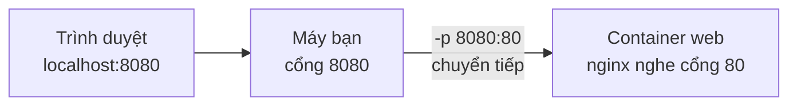

# Chạy container đầu tiên và mở cổng

Bài này chạy **nginx** (đọc là "engine-x"), một web server rất phổ biến. Image `nginx:1.30-alpine` có sẵn nginx bản 1.30 trên Alpine Linux. Chương 2 sẽ dùng chính image này làm nền để đóng gói trang web của bạn.

Trên Windows, gõ lệnh trong **PowerShell** (tab **Cài đặt** giải thích vì sao không dùng Git Bash).

## 1. Tải image về: pull

```bash
docker pull nginx:1.30-alpine
```

**Đọc hiểu:**

- `pull` = *kéo*: tải image `nginx` tag `1.30-alpine` từ Docker Hub về máy.
- Output có nhiều dòng `Pull complete`, mỗi dòng là một **layer** (lớp) của image. Chương 2 giải thích layer.
- Kiểm tra image đã về: `docker image ls nginx`.

Bước này không bắt buộc: `docker run` tự pull nếu máy chưa có image. Tách ra để bạn thấy rõ hai việc khác nhau: **tải** image và **chạy** container.

## 2. Chạy container nền

```bash
docker run -d --name web -p 8080:80 nginx:1.30-alpine
```

**Đọc hiểu**, từng phần:

| Phần | Chữ đầy đủ, nghĩa | Làm gì |
| --- | --- | --- |
| `docker run` | *chạy* | Tạo một container **mới** từ image rồi khởi động nó |
| `-d` | *detached*, tách ra | Chạy nền, trả lại terminal cho bạn ngay. Thiếu `-d` thì terminal bị log của nginx chiếm, Ctrl+C là container dừng |
| `--name web` | *tên* | Đặt tên container là `web` để gọi cho dễ. Không đặt thì Docker tự đặt tên ngẫu nhiên kiểu `quirky_turing` |
| `-p 8080:80` | *publish*, công bố | Nối cổng **8080 trên máy bạn** với cổng **80 trong container** (mục 3) |
| `nginx:1.30-alpine` | | Image dùng để tạo container. **Luôn đứng sau** các cờ |

Kết quả là một chuỗi dài như `9a1abbb8734c…`: đó là ID của container mới.

Mở trình duyệt tới <http://localhost:8080>: trang **Welcome to nginx!**. Hoặc dùng dòng lệnh:

```bash
curl http://localhost:8080
```

Trên Windows PowerShell gõ `curl.exe http://localhost:8080` (chữ `curl` không có `.exe` là một lệnh khác của PowerShell). Thấy dòng `<title>Welcome to nginx!</title>` trong kết quả là đúng.

## 3. Bản chất của -p: cổng là "số phòng"

Một máy tính chạy nhiều chương trình mạng cùng lúc. **Port** (*cổng*) là con số (0 tới 65535) giúp phân biệt chúng, giống **số phòng** trong một tòa nhà có chung địa chỉ. Gói tin tới "địa chỉ máy, phòng 8080" thì đi vào chương trình đang lắng nghe cổng 8080.

Container có **mạng riêng**, như một tòa nhà khác nằm trong khuôn viên máy bạn. nginx trong container lắng nghe phòng 80 **của tòa nhà container**. Từ máy bạn, gõ `localhost:80` là gõ cửa phòng 80 **của máy bạn**, không phải của container. Vì vậy cần `-p`: nó dựng một đường chuyển tiếp, "ai gõ cửa phòng 8080 của máy này thì dẫn sang phòng 80 của container `web`".




Quy tắc duy nhất cần nhớ: **`-p cổng-máy-bạn:cổng-trong-container`**. Bên phải do ứng dụng quyết định (nginx là 80, Postgres là 5432). Bên trái bạn tự chọn, miễn còn trống.

| Lệnh | Mở trang ở đâu | Vì sao |
| --- | --- | --- |
| `-p 8080:80` | `localhost:8080` | máy bạn 8080 → container 80 |
| `-p 3000:80` | `localhost:3000` | máy bạn 3000 → container 80 |
| `-p 80:8080` | không mở được | máy bạn 80 → container 8080, nhưng nginx đâu có nghe 8080 |
| không có `-p` | không mở được từ máy bạn | không có đường chuyển tiếp nào |

Muốn chạy hai nginx cùng lúc? Hai container đều nghe cổng 80 **bên trong** (mỗi container một tòa nhà riêng, không đụng nhau), chỉ cần khác cổng **bên ngoài**: `-p 8080:80` và `-p 8081:80`.

## 4. Xem container đang chạy: ps

```bash
docker ps
```

```text
CONTAINER ID   IMAGE               COMMAND                  CREATED         STATUS         PORTS                                     NAMES
66f1351893e6   nginx:1.30-alpine   "/docker-entrypoint.…"   2 seconds ago   Up 2 seconds   0.0.0.0:8080->80/tcp, [::]:8080->80/tcp   web
```

**Đọc hiểu:**

- `ps` = *process status* (trạng thái tiến trình), mượn tên lệnh `ps` của Linux. Nhớ lại bài 1: container là tiến trình.
- `STATUS` `Up 2 seconds`: đang chạy được 2 giây.
- `PORTS` `0.0.0.0:8080->80/tcp`: cổng 8080 trên mọi địa chỉ của máy bạn chuyển vào cổng 80 của container. Dòng `[::]` là cùng ý đó cho IPv6.
- `NAMES` `web`: tên bạn đặt bằng `--name`.

`docker ps` chỉ hiện container **đang chạy**. Thêm `-a` (*all*, tất cả) để thấy cả container đã dừng. Bài sau dùng nhiều.

## 5. Thử: chạy container thứ hai

```bash
docker run -d --name web2 -p 8081:80 nginx:1.30-alpine
docker ps
```

**Đọc hiểu:** cùng image, container mới tên `web2`, cổng ngoài 8081. Mở <http://localhost:8081>: cũng là trang nginx. `docker ps` giờ có hai dòng. Đây chính là "một công thức, hai món" ở bài 1.

Dọn `web2` (bài sau giải thích kỹ lệnh này), giữ `web` cho bài sau:

```bash
docker rm -f web2
```

## 6. Sai lầm thường gặp

| Sai lầm | Hậu quả | Đúng |
| --- | --- | --- |
| Đảo thứ tự `-p 80:8080` | Trang không mở được dù `docker ps` thấy container chạy | Cổng **máy bạn** bên trái, cổng **container** bên phải |
| Đặt cờ sau tên image: `docker run nginx:1.30-alpine -d` | `-d` bị coi là lệnh chạy **bên trong** container: chạy ở chế độ thường (không nền) và báo `/docker-entrypoint.sh: exec: line 47: illegal option -d`, rồi container thoát, nằm lại trong `docker ps -a` | Mọi cờ đứng **trước** tên image; dọn container lỗi bằng `docker ps -a` rồi `docker rm <tên>` |
| Nghĩ `EXPOSE` hay "image có cổng 80" là đủ | Không truy cập được từ máy | Luôn cần `-p` để mở ra máy bạn |
| Chạy lại cùng lệnh lần hai | Lỗi trùng tên hoặc trùng cổng | Mỗi `run` tạo container **mới**; container cũ vẫn còn (bài sau) |

## 7. Ngoài thực tế

Trên máy chủ thật, người ta hiếm khi mở thẳng cổng của từng container ra internet. Thường chỉ **một** container được `-p 80:80` và `-p 443:443`: một **reverse proxy** (*proxy ngược*, người gác cổng đứng trước các ứng dụng) như nginx hay Caddy. Nó nhận mọi yêu cầu từ internet, xem yêu cầu muốn tới ứng dụng nào, rồi chuyển vào đúng container ứng dụng qua mạng nội bộ (chương 4). Database **không bao giờ** được mở cổng ra ngoài. Ít cổng mở thì ít chỗ bị tấn công.

Khi làm nhóm trên máy cá nhân, nhóm thống nhất bảng cổng (web 8080, API 3000, database không mở) và ghi vào README, để ai chạy cũng giống nhau và không giẫm cổng của nhau.

## 8. Khi bị lỗi

| Lỗi | Vì sao | Cách sửa |
| --- | --- | --- |
| `Bind for 0.0.0.0:8080 failed: port is already allocated` | Cổng 8080 của máy đang bị một container hay chương trình khác dùng | `docker ps` tìm container giữ cổng rồi `docker rm -f <tên>`, hoặc đổi sang `-p 8081:80` |
| `Conflict. The container name "/web" is already in use` | Đã có container tên `web`, có thể đang dừng | `docker rm -f web` rồi chạy lại |
| `Unable to find image … pull access denied` | Gõ sai tên hoặc tag image | Kiểm tra chính tả: `nginx:1.30-alpine` |
| Trang không mở được dù `docker ps` thấy container | Sai thứ tự `-p` | Phải là `8080:80` |
| Lỗi khác, hoặc chưa hiểu vì sao | | Nhắn mentor, công khai hay **nhắn riêng** đều được (tab **Cài đặt** → "Hỏi ở đâu") |

## Tóm tắt

- `docker pull` tải image; `docker run` tạo **container mới** từ image và chạy nó.
- `-d` chạy nền, `--name` đặt tên, `-p máy:container` nối cổng.
- Container có mạng riêng; không có `-p` thì máy bạn không vào được.
- `docker ps` xem container đang chạy, `-a` xem tất cả.
