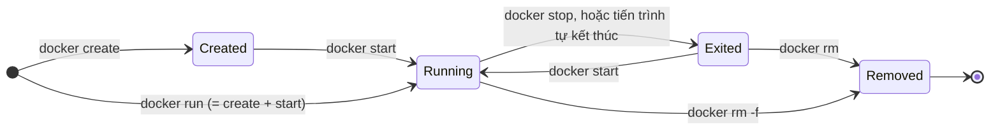

# Vòng đời container: xem log, vào trong, dừng, xóa

Bài trước để lại container `web` đang chạy. Bài này đi qua **mọi trạng thái** của nó, từ lúc tạo tới lúc xóa.

## 1. Vòng đời container

Một container luôn ở một trong vài trạng thái. Mỗi mũi tên là một lệnh (hoặc một sự kiện):



| Trạng thái | `docker ps -a` hiện | Nghĩa | Lớp ghi (file container tạo ra) |
| --- | --- | --- | --- |
| **Created** | `Created` | Đã tạo, chưa chạy lần nào | Có, còn trống |
| **Running** | `Up 5 minutes` | Tiến trình đang chạy | Còn |
| **Exited** | `Exited (0) 3 seconds ago` | Tiến trình đã dừng. Số trong ngoặc là mã thoát: `0` là bình thường, khác `0` là lỗi | **Vẫn còn** |
| **Removed** | không còn trong danh sách | Đã xóa hẳn | **Mất** |

Hai trạng thái hay nhầm là **Exited** và **Removed**. Container Exited giống cái laptop đang **tắt máy**: mọi file vẫn còn, `start` là chạy lại. Removed là **vứt laptop đi**: không còn gì để mở lại.

`docker run` chính là `create` + `start` gộp làm một. Thực tế bạn ít khi gõ `create` riêng.

## 2. Xem log: logs

```bash
docker logs web
docker logs -f web
```

**Đọc hiểu:**

- `logs` = *nhật ký*: in ra những gì tiến trình trong container đã in ra màn hình. Vì bạn chạy `-d`, những dòng đó không hiện ở terminal; Docker giữ lại cho bạn xem.
- `-f` = *follow*, theo dõi: in tiếp dòng mới khi có, như xem trực tiếp. Bấm **Ctrl+C** để thôi theo dõi; container **không** dừng.

Mở <http://localhost:8080> vài lần trong lúc chạy `docker logs -f web`. Mỗi lần là một dòng mới:

```text
172.17.0.1 - - [24/Nov/2026:03:23:34 +0000] "GET / HTTP/1.1" 200 896 "-" "Mozilla/5.0 …"
```

Dòng đó nói: có người gọi `GET /`, nginx trả mã `200` (thành công), 896 byte. Khi container chạy không như ý, **`docker logs` luôn là chỗ xem đầu tiên**.

## 3. Vào bên trong: exec

```bash
docker exec web ls /usr/share/nginx/html
```

```text
50x.html
index.html
```

**Đọc hiểu:**

- `exec` = *execute*, thực thi: chạy **thêm** một lệnh bên trong container **đang chạy**.
- `ls /usr/share/nginx/html` liệt kê thư mục nginx phục vụ. `index.html` chính là trang "Welcome to nginx!". Chương 2 sẽ thay file này bằng trang của bạn.

Muốn mở hẳn một shell để đi lại bên trong:

```bash
docker exec -it web sh
```

**Đọc hiểu:**

- `-it` = `-i` (*interactive*, tương tác: giữ bàn phím nối vào) + `-t` (*tty*, cấp một màn hình terminal). Thiếu `-it` thì shell mở ra rồi đóng ngay vì không có ai gõ.
- `sh` là shell có sẵn trong Alpine. (Image Alpine không có `bash`.)

Dấu nhắc đổi thành `/ #`: bạn đang ở **trong** container. Thử:

```bash
cat /etc/os-release
ps
exit
```

**Đọc hiểu:** `cat /etc/os-release` cho thấy đây là Alpine Linux, dù máy bạn là Windows hay macOS. `ps` chỉ thấy vài tiến trình nginx và shell của bạn, không thấy Chrome hay VS Code của máy bạn: đó là sự **cách ly** ở bài 1. `exit` ra khỏi shell; container **vẫn chạy**.

## 4. Biến môi trường: -e

Nhiều image đọc cấu hình từ **biến môi trường** (*environment variable*): các cặp `TÊN=giá trị` đưa vào tiến trình lúc chạy. Image không đổi, chỉ cấu hình đổi. Ví dụ Postgres đọc mật khẩu từ `POSTGRES_PASSWORD` (chương 4).

Thử với `alpine`, một image Linux tối giản:

```bash
docker run --rm -e TEN=An alpine:3.22 sh -c 'echo "Xin chao $TEN"'
```

```text
Xin chao An
```

**Đọc hiểu:**

- `--rm`: tự xóa container khi nó kết thúc.
- `-e TEN=An`: đặt biến môi trường `TEN` có giá trị `An` bên trong container.
- `alpine:3.22`: image. Mọi thứ **sau** tên image là lệnh chạy trong container.
- `sh -c '...'`: nhờ shell chạy câu lệnh trong dấu nháy. `$TEN` được thay bằng `An` **bên trong** container.

Đổi `-e TEN=Binh` và chạy lại: kết quả đổi, image vẫn là một. Đó là cách một image dùng được ở nhiều nơi với cấu hình khác nhau.

## 5. Dừng, chạy lại, xóa

Đi lại đúng sơ đồ ở mục 1:

```bash
docker stop web
docker ps -a
docker start web
docker ps
```

**Đọc hiểu:**

- `stop` gửi tín hiệu bảo nginx tắt. `docker ps -a` hiện `web` với `Exited (0)`: đã dừng, mã `0` là tắt bình thường. `docker ps` (không `-a`) thì không thấy nó nữa.
- `start` chạy lại **đúng container cũ** (cùng tên, cùng cổng, cùng file). Không phải container mới.

```bash
docker rm web
```

Lệnh trên **báo lỗi** vì `web` đang chạy:

```text
Error response from daemon: cannot remove container "web": container is running: stop the container before removing or force remove
```

Hai cách:

```bash
docker stop web
docker rm web
```

hoặc gộp:

```bash
docker rm -f web
```

**Đọc hiểu:** `rm` = *remove*, xóa container (phải đang dừng). `-f` = *force*, ép: dừng rồi xóa luôn. Xóa container là xóa luôn mọi file được tạo **bên trong** nó. Chương 4 học cách giữ dữ liệu bằng volume.

Xóa image khi không dùng nữa:

```bash
docker image ls
docker image rm alpine:3.22
```

Image đang có container dùng (kể cả container đã dừng) thì không xóa được; xóa container trước.

## 6. Sai lầm thường gặp

| Sai lầm | Thật ra |
| --- | --- |
| Gõ `docker run` để "mở lại" container đã dừng | `run` luôn tạo container **mới**. Mở lại container cũ thì dùng `start` |
| Sửa file trong container bằng `exec` rồi nghĩ là đã lưu | Sửa đó nằm trong lớp ghi của container, mất khi `rm`, và image không đổi. Muốn đổi lâu dài thì sửa Dockerfile (chương 2) |
| `Ctrl+C` khi đang `logs -f` làm dừng container | Không. `Ctrl+C` chỉ thôi theo dõi log |
| Để hàng chục container Exited | Chúng vẫn chiếm ổ đĩa. Thỉnh thoảng `docker ps -a` và dọn |

## 7. Ngoài thực tế

Khi một dịch vụ ở công ty có sự cố, người trực (on-call) gần như luôn làm theo thứ tự trong bài này:

1. `docker ps -a`: container nào `Exited`, nào đang chạy lại liên tục?
2. `docker logs --tail 100 <tên>`: đọc 100 dòng cuối tìm thông báo lỗi.
3. `docker exec -it <tên> sh`: vào xem file cấu hình, thử gọi mạng.

Nhưng **không sửa tay trong container** trên máy chủ thật. Sửa tay thì lần deploy sau mất hết, và không ai biết đã sửa gì. Sửa trong code hoặc Dockerfile, build image mới, rồi thay container. Container được coi như đồ **dùng xong vứt, thay bằng cái mới**.

## 8. Khi bị lỗi

| Lỗi | Vì sao | Cách sửa |
| --- | --- | --- |
| `container is running: stop the container before removing` | `rm` chỉ xóa container đã dừng | `docker stop` trước, hoặc `docker rm -f` |
| `No such container: web` | Gõ sai tên, hoặc container đã bị xóa | `docker ps -a` xem tên đúng |
| `ls: C:/Program Files/Git/usr/share/nginx/html: No such file or directory` | Đang dùng Git Bash, nó đổi đường dẫn | Dùng PowerShell |
| `exec: "bash": executable file not found` | Image Alpine không có `bash` | Dùng `sh` |
| `image is being used by stopped container` khi xóa image | Còn container (đã dừng) dùng image đó | `docker ps -a`, `docker rm` container đó trước |
| Lỗi khác, hoặc chưa hiểu vì sao | | Nhắn mentor, công khai hay **nhắn riêng** đều được (tab **Cài đặt** → "Hỏi ở đâu") |

## Tóm tắt

| Lệnh | Làm gì | Trạng thái sau |
| --- | --- | --- |
| `docker run -d --name web -p 8080:80 <image>` | tạo container mới và chạy | Running |
| `docker logs -f web` | xem log | không đổi |
| `docker exec -it web sh` | mở shell bên trong | không đổi |
| `docker stop web` | dừng | Exited |
| `docker start web` | chạy lại container cũ | Running |
| `docker rm web` / `docker rm -f web` | xóa | Removed |
| `docker run --rm -e KEY=value <image> <lệnh>` | chạy một lần với biến môi trường, tự xóa | Removed khi xong |
