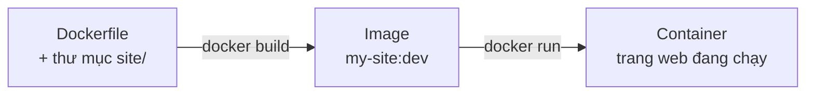

# Dockerfile đầu tiên: đóng gói một trang web

Chương 1 chạy image người khác làm sẵn. Giờ bạn tự làm image chứa **trang web của bạn**: lấy `nginx:1.30-alpine` làm nền, rồi chép trang web vào.

## 1. Chuẩn bị trang web

Bạn đã có portfolio HTML/CSS? Dùng nó. Chưa có thì tạo bộ khởi đầu dưới đây, chỉ hai file.

Tạo thư mục dự án `my-site`, bên trong có thư mục con `site`:

```text
my-site/
└── site/
    ├── index.html
    └── style.css
```

`site/index.html`:

```html
<!doctype html>
<html lang="vi">
<head>
  <meta charset="utf-8">
  <meta name="viewport" content="width=device-width, initial-scale=1">
  <title>Trang của mình</title>
  <link rel="stylesheet" href="style.css">
</head>
<body>
  <h1>Xin chào, mình là An</h1>
  <p>Trang này đang chạy trong một container Docker.</p>
</body>
</html>
```

`site/style.css`:

```css
body {
  font-family: system-ui, sans-serif;
  max-width: 40rem;
  margin: 3rem auto;
  padding: 0 1rem;
}
h1 { color: #1a73e8; }
```

**Đọc hiểu:** `index.html` là trang chủ (web server tự tìm file tên này), dòng `<link rel="stylesheet" href="style.css">` nạp file CSS nằm cùng thư mục. Đổi "An" thành tên bạn. Dùng portfolio của bạn thì chép toàn bộ file trang web (HTML, CSS, ảnh) vào `site/`.

Vì sao để trang web trong thư mục con `site/` mà không để ở gốc? Gốc dự án sẽ có thêm `Dockerfile`, `README.md`, sau này cả file mật khẩu `.env`. Những file đó **không được** lọt ra cho người xem trang web. Tách riêng `site/` là cách đơn giản nhất. Chương 3 học thêm `.dockerignore`.

## 2. Dockerfile là gì

**Dockerfile** là file văn bản liệt kê **từng bước tạo một image**, như một công thức nấu ăn ghi từng bước. Docker đọc từ trên xuống. Việc đọc Dockerfile và tạo image gọi là **build** (*xây dựng*).



**Đọc hiểu sơ đồ:** hai bước, hai lệnh, hai thời điểm. **Lúc build**: Dockerfile + file của bạn → image. **Lúc chạy**: image → container. Sửa trang web thì phải build lại image, vì image là bản chụp **đã đóng băng** ở lúc build.

## 3. Viết Dockerfile

Ở thư mục gốc `my-site/` (cạnh thư mục `site/`), tạo file tên **đúng là** `Dockerfile`: chữ D hoa, không có đuôi.

```dockerfile
# Image nền: nginx bản 1.30 trên Alpine Linux
FROM nginx:1.30-alpine

# Chép thư mục site/ vào thư mục nginx phục vụ mặc định
COPY site/ /usr/share/nginx/html/

# Ghi chú: nginx lắng nghe cổng 80 bên trong container
EXPOSE 80
```

**Đọc hiểu**, từng dòng:

| Dòng | Nghĩa đen | Làm gì |
| --- | --- | --- |
| `# ...` | | Chú thích, Docker bỏ qua |
| `FROM nginx:1.30-alpine` | *từ* | Chọn **base image** (*image nền*). Image của bạn bắt đầu từ mọi thứ có trong `nginx:1.30-alpine`: Alpine Linux, nginx, cấu hình sẵn. Mọi Dockerfile bắt đầu bằng `FROM` |
| `COPY site/ /usr/share/nginx/html/` | *chép* | Chép **nội dung** thư mục `site/` trên máy bạn vào thư mục `/usr/share/nginx/html/` trong image. Đây chính là thư mục bạn đã `ls` ở chương 1, nơi có trang "Welcome to nginx!". File `index.html` của bạn ghi đè file cũ |
| `EXPOSE 80` | *phơi ra* | Chỉ là **ghi chú** rằng container lắng nghe cổng 80. Nó **không** mở cổng ra máy bạn. Bạn vẫn cần `-p` khi chạy |

Không cần dòng lệnh khởi động: image `nginx` đã có sẵn lệnh chạy nginx, image của bạn **thừa hưởng** nó.

## 4. Build

Đứng ở thư mục `my-site/` (nơi có `Dockerfile`):

```bash
docker build -t my-site:dev .
```

**Đọc hiểu:**

- `build`: đọc `Dockerfile`, tạo image.
- `-t my-site:dev`: `-t` = *tag*, đặt tên `my-site` và tag `dev` cho image. Bài 3 nói kỹ về tag.
- `.` ở cuối: **build context** (*bối cảnh build*), thư mục bạn đưa cho Docker. Docker tìm `Dockerfile` trong đó, và `COPY` chỉ lấy được file **nằm trong** thư mục này. `.` nghĩa là "thư mục hiện tại". **Đừng quên dấu chấm.**

Output kết thúc bằng dòng `naming to docker.io/library/my-site:dev` là xong. Kiểm tra:

```bash
docker image ls my-site
```

```text
IMAGE         ID             DISK USAGE   CONTENT SIZE   EXTRA
my-site:dev   4b94d65cdf41       92.7MB         26.1MB
```

**Đọc hiểu:** image `my-site:dev` đã nằm trên máy. `CONTENT SIZE` là dung lượng nén (lúc tải về), `DISK USAGE` là dung lượng đã giải nén trên ổ đĩa. Gần như toàn bộ là của nginx và Alpine; trang web của bạn chỉ vài KB. (Bản Docker cũ hiện cột `SIZE` thay vì hai cột này.)

## 5. Chạy

```bash
docker run -d --name my-site -p 8080:80 my-site:dev
```

**Đọc hiểu:** giống hệt chương 1, chỉ khác image: `my-site:dev` thay cho `nginx:1.30-alpine`. Container tên `my-site`, cổng 8080 của máy bạn nối vào cổng 80 của nginx.

Mở <http://localhost:8080>: trang của bạn, có màu xanh của CSS. Kiểm tra bằng dòng lệnh (Windows: `curl.exe`):

```bash
curl http://localhost:8080
```

Thấy dòng `<h1>Xin chào, mình là An</h1>` là đúng. Thử mở <http://localhost:8080/Dockerfile>: trang **404 Not Found**, vì `Dockerfile` nằm ngoài `site/` nên không được chép vào image.

## 6. Sửa trang thì build lại

Sửa chữ trong `site/index.html` rồi tải lại trình duyệt: **chưa đổi**. Image đã đóng băng bản cũ, container chạy từ image đó. Phải làm ba bước:

```bash
docker rm -f my-site
docker build -t my-site:dev .
docker run -d --name my-site -p 8080:80 my-site:dev
```

**Đọc hiểu:** xóa container cũ (giải phóng tên và cổng 8080), build image mới cùng tên `my-site:dev`, chạy container mới từ image mới. Chương 5, Docker Compose gộp ba bước này thành một lệnh.

## 7. Sai lầm thường gặp

| Sai lầm | Hậu quả | Đúng |
| --- | --- | --- |
| File tên `Dockerfile.txt` (Windows ẩn đuôi file) | `failed to read dockerfile` | Trong VS Code, tạo file mới gõ đúng `Dockerfile`; bật "File name extensions" trong File Explorer để thấy đuôi |
| Quên dấu `.` cuối lệnh build | `docker buildx build requires 1 argument` | `docker build -t my-site:dev .` |
| `COPY site /usr/share/nginx/html` mà thiếu thư mục `site` | `"/site": not found` | Đứng đúng thư mục `my-site/`, kiểm tra tên thư mục |
| `COPY ../anh.png …` lấy file ngoài thư mục | lỗi `not found` | `COPY` chỉ thấy file trong build context. Chép file vào `site/` |
| Nghĩ `EXPOSE 80` đã mở cổng | Không vào được trang | Vẫn cần `-p 8080:80` |
| Sửa HTML mà không build lại | Trang không đổi | Build lại, chạy container mới |

## 8. Ngoài thực tế

Trong một dự án nhóm, `Dockerfile` nằm ở gốc repo và được **commit cùng code**. Ai sửa cách đóng gói thì sửa Dockerfile và mở pull request như sửa code: bạn cùng nhóm review, build thử. Nhờ vậy cách tạo image được ghi lại, có lịch sử, không phụ thuộc trí nhớ của một người.

Ở công ty, image thường **không build trên laptop** để đưa lên máy chủ. Máy CI build từ đúng commit đã được review, rồi đẩy lên registry (chương 7). Laptop chỉ build để thử.

## 9. Khi bị lỗi

| Lỗi | Vì sao | Cách sửa |
| --- | --- | --- |
| `failed to read dockerfile: open Dockerfile: no such file or directory` | Đứng sai thư mục, hoặc file tên `Dockerfile.txt` | `cd` vào `my-site/`; đổi tên file |
| `requires 1 argument` | Quên dấu `.` | Thêm `.` cuối lệnh |
| Trang hiện **Welcome to nginx!** thay vì trang của bạn | `index.html` không nằm trực tiếp trong `site/` | Kiểm tra `site/index.html` có đúng chỗ, rồi build lại |
| Trang hiện nhưng không có CSS | Đường dẫn CSS sai, hoặc `style.css` không nằm trong `site/` | Xem `docker exec my-site ls /usr/share/nginx/html` |
| `port is already allocated` / `name … already in use` | Container cũ còn | `docker rm -f my-site` |
| Lỗi khác, hoặc chưa hiểu vì sao | | Nhắn mentor, công khai hay **nhắn riêng** đều được (tab **Cài đặt** → "Hỏi ở đâu") |

## Tóm tắt

- Dockerfile là công thức tạo image: `FROM` chọn image nền, `COPY` đưa file vào, `EXPOSE` chỉ là ghi chú.
- `docker build -t tên:tag .` tạo image; dấu `.` là build context.
- Image đóng băng lúc build: sửa code thì build lại và chạy container mới.
