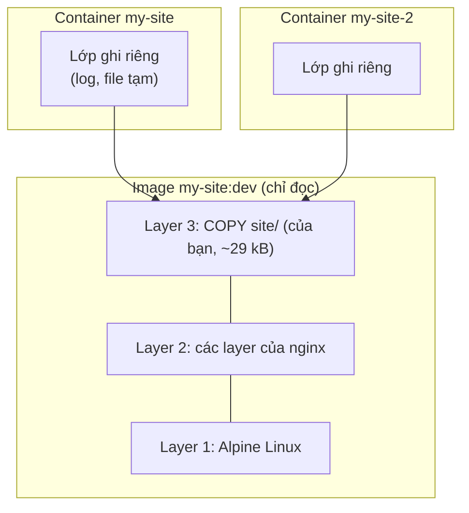
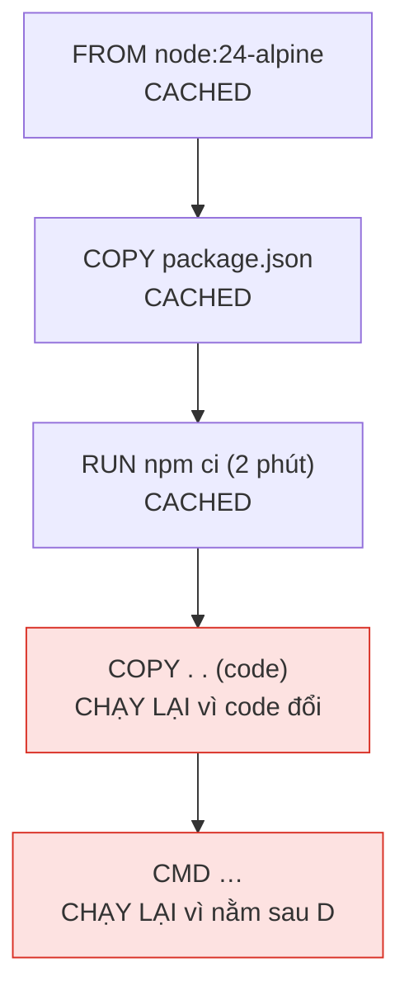

# Layer và cache: vì sao build lần hai nhanh

Bài trước build image `my-site:dev`. Bài này mở image ra xem bên trong nó được xếp thế nào. Hiểu chỗ này thì bạn hiểu luôn vì sao container "quên" dữ liệu khi bị xóa (chương 4) và vì sao Dockerfile phải viết theo thứ tự nhất định.

## 1. Image là một chồng layer

Image không phải một khối liền. Nó là **một chồng layer** (*lớp*), xếp như các tầng bánh. Mỗi lệnh `FROM`, `COPY`, `RUN` trong Dockerfile tạo ra một layer chứa **phần thay đổi** của bước đó so với các layer bên dưới.

- Mọi layer của image đều **chỉ đọc**, không bao giờ bị sửa.
- Khi chạy một container, Docker đặt thêm **một lớp mỏng ghi được** (*writable layer*) lên trên cùng, **riêng cho container đó**. Container tạo file, sửa file, xóa file: tất cả nằm ở lớp này.
- Xóa container là bỏ lớp ghi đó đi. Các layer của image vẫn nguyên.




**Đọc hiểu sơ đồ:** hai container từ cùng một image **dùng chung** các layer chỉ đọc, chỉ có lớp ghi là riêng. Vì vậy chạy 10 container từ một image không tốn gấp 10 lần ổ đĩa. Và vì vậy `docker exec` sửa file trong container không làm đổi image (chương 1).

Xem các layer của image bằng `history` (*lịch sử*):

```bash
docker history my-site:dev
```

```text
IMAGE          CREATED         CREATED BY                                      SIZE      COMMENT
4b94d65cdf41   4 seconds ago   EXPOSE [80/tcp]                                 0B        buildkit.dockerfile.v0
<missing>      4 seconds ago   COPY site/ /usr/share/nginx/html/ # buildkit    28.7kB    buildkit.dockerfile.v0
<missing>      5 days ago      RUN /bin/sh -c set -x     && apkArch="$(cat …   51.8MB    buildkit.dockerfile.v0
<missing>      5 days ago      ENV ACME_VERSION=0.4.2                          0B        buildkit.dockerfile.v0
…
```

**Đọc hiểu:** đọc từ dưới lên là thứ tự build. Hai dòng trên cùng là của **bạn** (`COPY` nặng 28.7 kB, `EXPOSE` nặng 0 B vì chỉ là ghi chú). Các dòng dưới đến từ image `nginx:1.30-alpine`, được tạo "5 days ago" bởi người làm image nginx. `<missing>` không phải lỗi: các layer đó không có ID riêng trên máy bạn, bỏ qua được.

Thêm một điều có lợi: nhiều image dùng chung một base image thì layer nền **chỉ lưu và tải một lần**. Bạn pull `nginx:1.30-alpine` ở chương 1, nên lúc build `my-site` không phải tải lại.

## 2. Cache: dùng lại layer cũ

Build lại mà không sửa gì:

```bash
docker build -t my-site:dev .
```

```text
 => [1/2] FROM docker.io/library/nginx:1.30-alpine@sha256:8eb2b5…
 => CACHED [2/2] COPY site/ /usr/share/nginx/html/
```

**Đọc hiểu:** chữ `CACHED` nghĩa là Docker thấy **đầu vào** của bước này (lệnh và các file được chép) **giống hệt** lần trước, nên lấy lại layer cũ trong **cache** (*bộ nhớ đệm*) thay vì làm lại. Build xong gần như tức thì.

Giờ sửa một chữ trong `site/index.html` rồi build lại: dòng `COPY` **không còn** `CACHED`, vì file đã đổi.

Luật quan trọng nhất của cache:

> **Một bước thay đổi thì nó và MỌI bước sau nó đều phải chạy lại.**

Lý do: mỗi layer xây **lên trên** layer trước. Layer dưới đổi thì layer trên không còn đúng nữa, giống tầng bánh dưới thay thì phải làm lại các tầng trên.



## 3. Thứ tự lệnh: ít đổi ở trên, hay đổi ở dưới

Trang web tĩnh chỉ có một bước `COPY`, nên chưa thấy rõ. Với một ứng dụng Node.js thì khác. Hai lệnh mới, chỉ cần hiểu để đọc ví dụ:

- `WORKDIR /app` (*working directory*, thư mục làm việc): từ đây các lệnh sau chạy trong thư mục `/app` của image, tự tạo nếu chưa có.
- `RUN <lệnh>` (*chạy*): chạy một câu lệnh **lúc build**, kết quả lưu thành một layer. Ví dụ `RUN npm ci` cài thư viện Node (thường mất vài phút).

Thứ tự **sai**:

```dockerfile
FROM node:24-alpine
WORKDIR /app
COPY . .
RUN npm ci
```

Thứ tự **đúng**:

```dockerfile
FROM node:24-alpine
WORKDIR /app
# 1. Chỉ chép file khai báo thư viện, rồi cài thư viện (ít đổi, chậm)
COPY package.json package-lock.json ./
RUN npm ci
# 2. Rồi mới chép code, thứ bạn sửa mỗi ngày (hay đổi, nhanh)
COPY . .
```

**Đọc hiểu:**

- Bản sai: sửa **một dòng code** là `COPY . .` đổi, kéo theo `RUN npm ci` chạy lại, cài lại toàn bộ thư viện. Mỗi lần build mất vài phút.
- Bản đúng: sửa code thì chỉ `COPY . .` chạy lại. `npm ci` vẫn `CACHED` vì `package.json` không đổi. Build còn vài giây. Chỉ khi bạn thêm thư viện (đổi `package.json`) thì `npm ci` mới chạy lại, đúng như mong muốn.

Bạn không cần chạy ví dụ Node này; chương 3 có một ứng dụng thật để build. Chỉ cần nhớ nguyên tắc: **thứ ít đổi để lên trên, thứ hay đổi để xuống dưới.**

## 4. Sai lầm thường gặp

| Hiểu sai | Thật ra |
| --- | --- |
| "Mỗi container chép nguyên image ra một bản" | Các container dùng chung layer chỉ đọc, chỉ lớp ghi là riêng |
| "Ghi file trong container là ghi vào image" | Ghi vào lớp ghi của container, mất khi `docker rm` |
| "`CACHED` nghĩa là build bị lỗi, dùng bản cũ" | `CACHED` là tốt: đầu vào không đổi nên kết quả không đổi |
| "Thứ tự trong Dockerfile không quan trọng" | Sai thứ tự làm mất cache, build chậm hơn nhiều lần |

## 5. Ngoài thực tế

Trong nhóm, một Dockerfile viết sai thứ tự có thể làm **mỗi lần CI chạy chậm thêm 5–10 phút**, nhân với hàng chục lần push mỗi ngày. Khi review pull request có sửa Dockerfile, người review thường hỏi đúng câu: "bước chậm có nằm trên bước hay đổi không?".

Máy CI cũng lưu cache giữa các lần build (track **GitHub Actions và Docker** có dạy), nhưng cache chỉ có ích khi Dockerfile xếp đúng thứ tự.

## 6. Khi bị lỗi

| Triệu chứng | Vì sao | Cách sửa |
| --- | --- | --- |
| Sửa code mà build xong trang vẫn cũ | Quên chạy container mới từ image mới | `docker rm -f my-site` rồi `docker run` lại |
| Build lần nào cũng chậm như lần đầu | Bước chậm nằm sau bước hay đổi | Đổi thứ tự như mục 3 |
| Muốn build lại hoàn toàn, bỏ qua cache | Nghi cache cũ gây lỗi lạ | `docker build --no-cache -t my-site:dev .` |
| Lỗi khác, hoặc chưa hiểu vì sao | | Nhắn mentor, công khai hay **nhắn riêng** đều được (tab **Cài đặt** → "Hỏi ở đâu") |

## Tóm tắt

- Image là chồng layer chỉ đọc; mỗi `FROM`, `COPY`, `RUN` tạo một layer.
- Mỗi container có thêm một lớp ghi riêng ở trên, mất khi xóa container.
- Layer có đầu vào không đổi được lấy từ cache (`CACHED`); một bước đổi thì các bước sau chạy lại.
- Ít đổi để trên, hay đổi để dưới.
