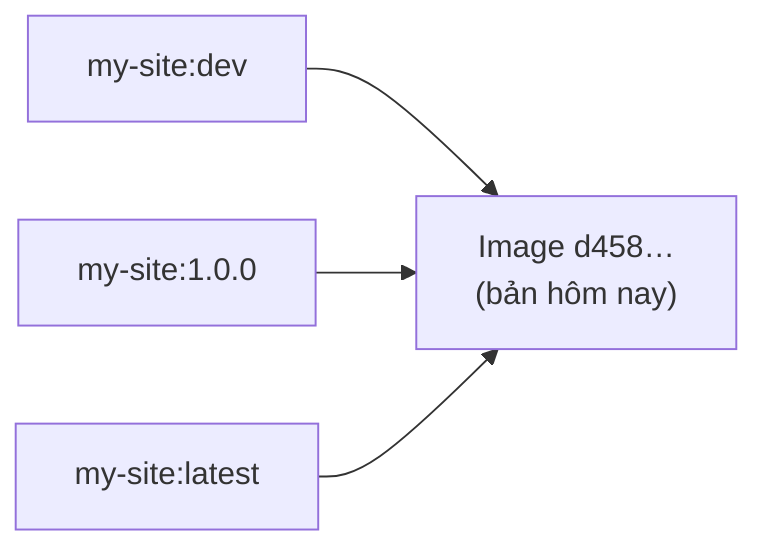

# Tag: đặt tên phiên bản cho image

Bạn đã build `my-site:dev`. Phần `dev` sau dấu hai chấm là **tag** (*nhãn*). Bài này học cách dùng tag để phân biệt các phiên bản của cùng một image.

## 1. Tag là nhãn dán, không phải bản sao

```bash
docker tag my-site:dev my-site:1.0.0
docker image ls my-site
```

```text
IMAGE           ID             DISK USAGE   CONTENT SIZE   EXTRA
my-site:1.0.0   d458a354e3cb       92.7MB         26.1MB
my-site:dev     d458a354e3cb       92.7MB         26.1MB
```

**Đọc hiểu:**

- `docker tag <tên-cũ> <tên-mới>`: dán thêm một nhãn mới lên **cùng một image**.
- Cột `ID` của hai dòng **giống hệt nhau**: chỉ có một image, hai cái tên. Không tốn thêm ổ đĩa.

Ví von: image là một cuốn sách, tag là **mẩu giấy ghi chú** dán lên gáy sách. Dán bao nhiêu mẩu cũng chỉ có một cuốn. Và mẩu giấy có thể **bóc ra dán sang cuốn khác**.



Build lại `my-site:dev` sau khi sửa code: nhãn `dev` bị **bóc ra dán sang image mới**, còn `1.0.0` vẫn trỏ vào image cũ. Đó là cách giữ lại một phiên bản đã chốt.

Gắn tag ngay lúc build cũng được, thêm nhiều `-t`:

```bash
docker build -t my-site:1.0.0 -t my-site:dev .
```

## 2. latest: chỉ là một cái tên

Không ghi tag thì Docker tự hiểu là `latest` (*mới nhất*): `docker run nginx` chính là `docker run nginx:latest`.

Nhiều người tưởng `latest` luôn là bản mới nhất. Thật ra `latest` **chỉ là một tag như mọi tag khác**:

- Nó không tự cập nhật trên máy bạn. Bạn pull `nginx:latest` tháng trước thì máy bạn vẫn giữ bản tháng trước.
- Trên registry, người làm image có thể dán nó sang bản mới bất cứ lúc nào. Hôm nay `latest` là 1.30, tháng sau có thể là 1.31 với thay đổi làm hỏng cấu hình của bạn.
- Nhìn chữ `latest` không biết đang chạy phiên bản nào.

Vì vậy, quy tắc của track: **luôn ghi tag cụ thể cho image nền**, như `nginx:1.30-alpine`, `postgres:18-alpine`. Hôm nay build được thì tháng sau build vẫn ra cùng kết quả.

## 3. Quy ước tag hay gặp

| Tag | Dùng khi | Có bị ghi đè không |
| --- | --- | --- |
| `1.0.0`, `1.1.0` | Phiên bản phát hành (chương 7 nói kỹ cách đánh số) | **Không bao giờ** ghi đè |
| `1.30-alpine` | Phiên bản + biến thể (bản trên Alpine) | Có thể được cập nhật bản vá nhỏ |
| `dev` | Bản đang làm trên máy bạn | Có, liên tục |
| `latest` | Bản mới nhất, tiện nhưng mơ hồ | Có |

## 4. Dọn image

Build nhiều lần thì image cũ chất đống. Xem và dọn:

```bash
docker image ls
docker image rm my-site:1.0.0
docker image prune
```

**Đọc hiểu:**

- `docker image rm my-site:1.0.0`: gỡ **nhãn** `1.0.0`. Image chỉ thật sự bị xóa khi không còn nhãn nào và không còn container nào dùng nó.
- `docker image prune` (*prune* = tỉa cành): xóa các **dangling image** (*image lơ lửng*), tức image cũ đã bị bóc hết nhãn sau nhiều lần build lại, hiện tên `<none>`. Docker hỏi `Are you sure you want to continue? [y/N]`, gõ `y`.

## 5. Sai lầm thường gặp

| Sai lầm | Hậu quả | Đúng |
| --- | --- | --- |
| `FROM nginx` hay `FROM nginx:latest` | Tháng sau build ra image khác, có thể hỏng | `FROM nginx:1.30-alpine` |
| Nghĩ `docker tag` tạo bản sao | Lo tốn ổ đĩa, hoặc tưởng sửa bản này không ảnh hưởng bản kia | Tag chỉ là tên trỏ vào image |
| Ghi đè tag phiên bản `1.0.0` bằng code mới | Không ai biết `1.0.0` là bản nào nữa | Code mới thì tag mới `1.0.1` |

## 6. Ngoài thực tế

Ở công ty, mỗi lần phát hành thường tạo **một tag Git** (ví dụ `v1.2.0`) và **một tag image** cùng số. Khi bản mới bị lỗi, người trực chỉ cần chạy lại image tag cũ (`1.1.0`) là quay về bản trước trong vài giây (gọi là **rollback**). Nếu chỉ có `latest` thì không còn bản cũ nào để quay về. Chương 7 làm việc này với registry.

## 7. Khi bị lỗi

| Lỗi | Vì sao | Cách sửa |
| --- | --- | --- |
| `invalid reference format` | Tên image có chữ hoa hoặc ký tự lạ | Tên image chỉ dùng chữ thường, số, `-`, `_`, `.` |
| `image is being used by running container` khi xóa | Còn container dùng image | `docker rm -f` container đó trước |
| `No such image` | Gõ sai tên hoặc tag | `docker image ls` xem tên đúng |
| Lỗi khác, hoặc chưa hiểu vì sao | | Nhắn mentor, công khai hay **nhắn riêng** đều được (tab **Cài đặt** → "Hỏi ở đâu") |

## Tóm tắt

- Tag là nhãn trỏ vào một image; nhiều tag có thể trỏ cùng một image.
- `latest` chỉ là tag mặc định, không tự cập nhật, không cho biết phiên bản. Luôn ghi tag cụ thể cho image nền.
- Tag phiên bản (`1.0.0`) không bao giờ ghi đè; dùng nó để rollback.
- `docker image rm` gỡ nhãn; `docker image prune` dọn image lơ lửng.
