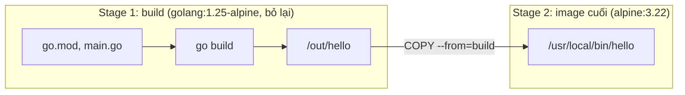

# Multi-stage build: bỏ bộ đồ nghề lại phía sau

Trang web tĩnh không cần "build": file HTML chép vào là chạy. Nhưng rất nhiều ứng dụng phải được **build trước** rồi mới chạy: chương trình Go, Java, C# phải biên dịch; trang React, Vue phải đóng gói thành HTML/JS. Bài này dùng một chương trình Go rất nhỏ để thấy vấn đề và cách giải.

**Bạn không cần biết Go, cũng không cần cài Go.** Mọi việc build diễn ra trong container. Chỉ cần biết: chương trình Go được **compile** (*biên dịch*) thành **một file chạy được duy nhất**.

## 1. Lúc build cần gì, lúc chạy cần gì

Ví von **xây nhà**: lúc xây cần cần cẩu, giàn giáo, máy trộn bê tông. Xây xong thì dỡ hết, người ở chỉ cần căn nhà. Không ai giao nhà kèm cả cần cẩu.

| | Lúc build | Lúc chạy |
| --- | --- | --- |
| Cần gì | Trình biên dịch Go, thư viện chuẩn, mã nguồn | **Chỉ** file chương trình đã build |
| Dung lượng | Vài trăm MB | Vài MB |
| Nếu để lại trong image | Image to, tải chậm, nhiều phần mềm thừa cho kẻ xấu lợi dụng | |

File được tạo ra từ bước build, như file chương trình đã biên dịch, gọi là **artifact** (*sản phẩm*).

## 2. Chuẩn bị ứng dụng

Tạo thư mục mới `hello-go` (ngoài thư mục `my-site`), với hai file.

`go.mod`:

```text
module hello

go 1.25
```

`main.go`:

```go
package main

import (
	"fmt"
	"net/http"
	"os/user"
)

func main() {
	http.HandleFunc("/", func(w http.ResponseWriter, r *http.Request) {
		u, _ := user.Current()
		fmt.Fprintf(w, "Xin chào từ Go! Tiến trình đang chạy với user: %s\n", u.Username)
	})
	fmt.Println("Đang lắng nghe ở cổng 8080")
	http.ListenAndServe(":8080", nil)
}
```

**Đọc hiểu** (không cần nhớ cú pháp Go):

- `go.mod` khai báo tên module `hello` và phiên bản Go cần dùng.
- `main.go` là một web server nhỏ: ai gọi tới, nó trả lời một câu kèm **tên user** đang chạy tiến trình. Bài sau dùng thông tin này.
- `fmt.Println(...)` in một dòng ra log khi khởi động.
- `http.ListenAndServe(":8080", nil)` lắng nghe cổng **8080** bên trong container.

## 3. Cách thứ nhất: một stage

Tạo file `Dockerfile.single`:

```dockerfile
FROM golang:1.25-alpine
WORKDIR /src
COPY . .
RUN go build -o /hello .
EXPOSE 8080
CMD ["/hello"]
```

**Đọc hiểu:**

- `FROM golang:1.25-alpine`: image nền có sẵn **bộ công cụ Go** bản 1.25.
- `WORKDIR /src`, `COPY . .`: vào thư mục `/src`, chép mã nguồn vào (chương 2).
- `RUN go build -o /hello .`: **biên dịch** lúc build, `-o /hello` = *output*, ghi file chương trình ra `/hello`.
- `CMD ["/hello"]` (*command*, lệnh): lệnh **mặc định chạy khi container khởi động**. Khác `RUN`: `RUN` chạy **lúc build** và lưu kết quả vào layer; `CMD` chạy **lúc container chạy**. Trang nginx ở chương 2 không cần `CMD` vì image nginx đã có sẵn.

Build bằng file này (`-f` = *file*, chọn Dockerfile khác tên mặc định):

```bash
docker build -f Dockerfile.single -t hello-go:single .
```

## 4. Cách thứ hai: multi-stage build

Tạo file `Dockerfile`:

```dockerfile
# ---- Stage 1: build (có đủ bộ công cụ Go) ----
FROM golang:1.25-alpine AS build
WORKDIR /src
COPY go.mod ./
COPY *.go ./
RUN CGO_ENABLED=0 go build -o /out/hello .

# ---- Stage 2: chạy (chỉ có file đã build) ----
FROM alpine:3.22
RUN adduser -D -u 10001 app
COPY --from=build /out/hello /usr/local/bin/hello
USER app
EXPOSE 8080
CMD ["hello"]
```

**Đọc hiểu:**

- Dockerfile có **hai dòng `FROM`**, tức hai **stage** (*giai đoạn*). Đây là **multi-stage build** (*build nhiều giai đoạn*).
- `FROM golang:1.25-alpine AS build`: stage 1 đặt tên là `build` bằng `AS`.
- `COPY go.mod ./` rồi `COPY *.go ./`: chỉ chép đúng file cần để build (`*.go` là mọi file đuôi `.go`).
- `RUN CGO_ENABLED=0 go build -o /out/hello .`: biên dịch. `CGO_ENABLED=0` bảo Go tạo file **tự chứa đủ mọi thứ**, chạy được trên bất kỳ Linux nào, kể cả Alpine trơn.
- `FROM alpine:3.22`: stage 2 **bắt đầu lại từ đầu** với một image sạch, chỉ khoảng 8 MB, không có Go.
- `COPY --from=build /out/hello /usr/local/bin/hello`: chép **chỉ một file** từ stage `build` sang. `--from=build` là "lấy từ stage tên build", không phải từ máy bạn.
- Hai dòng `RUN adduser ...` và `USER app` tạo và dùng một user thường, bài sau giải thích.
- `CMD ["hello"]`: chạy chương trình (nằm trong `/usr/local/bin`, nên gọi tên là đủ).

**Image cuối cùng chỉ gồm những gì của stage cuối.** Toàn bộ stage `build`, với bộ công cụ Go vài trăm MB, bị **bỏ lại** sau khi build xong.




Build:

```bash
docker build -t hello-go:multi .
```

## 5. So sánh kích thước

```bash
docker image ls hello-go
```

```text
IMAGE             ID             DISK USAGE   CONTENT SIZE   EXTRA
hello-go:multi    521c36d7ce8d       25.4MB         8.33MB
hello-go:single   7cf3e5a40eb4        448MB         89.2MB
```

**Đọc hiểu:** cùng một chương trình, chạy giống hệt nhau, nhưng image multi-stage nhỏ hơn khoảng **17 lần** (25 MB so với 448 MB trên ổ đĩa). Con số của bạn có thể lệch một chút tuỳ phiên bản, tỉ lệ thì tương tự.

Image nhỏ có lợi gì?

- **Tải nhanh hơn**: máy chủ pull 8 MB thay vì 89 MB, deploy nhanh hơn.
- **Ít phần mềm thừa**: không có trình biên dịch, không có công cụ build trong image chạy, kẻ xấu vào được container cũng ít đồ nghề để dùng.
- **Ít lỗ hổng phải vá**: mỗi phần mềm thừa là một chỗ có thể có lỗi bảo mật.

## 6. Chạy thử

```bash
docker run -d --name hello -p 8080:8080 hello-go:multi
curl http://localhost:8080
docker logs hello
```

(Windows: `curl.exe`.) Kết quả:

```text
Xin chào từ Go! Tiến trình đang chạy với user: app
```

```text
Đang lắng nghe ở cổng 8080
```

**Đọc hiểu:** `-p 8080:8080` vì chương trình Go nghe cổng 8080 bên trong (khác nginx nghe 80). `docker logs` hiện dòng chương trình in lúc khởi động. Câu trả lời nói user là `app`: bài sau giải thích vì sao đây là điều tốt.

Dọn container, giữ image cho bài sau:

```bash
docker rm -f hello
```

## 7. Multi-stage cho trang React, Vue, Vite

Cùng ý tưởng, chỉ khác công cụ. Ví dụ một trang Vite (không cần làm, chỉ để đọc):

```dockerfile
FROM node:24-alpine AS build
WORKDIR /app
COPY package.json package-lock.json ./
RUN npm ci
COPY . .
RUN npm run build

FROM nginx:1.30-alpine
COPY --from=build /app/dist/ /usr/share/nginx/html/
```

**Đọc hiểu:** stage `build` có Node và hàng trăm MB thư viện trong `node_modules`, chạy `npm run build` để tạo thư mục `dist/` (HTML, JS, CSS đã đóng gói). Image cuối là nginx chỉ chứa `dist/`, không có Node, không có `node_modules`. Thứ tự `COPY package.json` → `RUN npm ci` → `COPY . .` chính là bài học cache ở chương 2.

## 8. Sai lầm thường gặp

| Sai lầm | Hậu quả | Đúng |
| --- | --- | --- |
| Quên `--from=build` trong `COPY` | `"/out/hello": not found` vì Docker tìm trên máy bạn | `COPY --from=build …` |
| Nghĩ image cuối chứa cả hai stage | | Chỉ stage **cuối cùng** thành image |
| Dùng `-p 8080:80` cho app Go | Trang không mở được | Bên phải là cổng app nghe: 8080 |

## 9. Ngoài thực tế

Gần như mọi Dockerfile của ứng dụng cần build ở công ty đều là multi-stage. Một số nhóm còn dùng image chạy siêu nhỏ như `scratch` (rỗng hoàn toàn) hay "distroless" (không có cả shell). Khi review Dockerfile, câu hỏi hay gặp là: "image cuối có chứa thứ gì chỉ cần lúc build không?". Có công cụ quét image (như Trivy, Docker Scout) chạy trong CI để báo lỗ hổng; image nhỏ thì danh sách lỗ hổng ngắn hơn hẳn.

## 10. Khi bị lỗi

| Lỗi | Vì sao | Cách sửa |
| --- | --- | --- |
| `"/out/hello": not found` khi build | Thiếu `--from=build`, hoặc sai đường dẫn | So đường dẫn `-o` ở stage 1 với `COPY --from` ở stage 2 |
| `go: go.mod requires go >= …` | Phiên bản trong `go.mod` mới hơn image `golang` | Dùng đúng `go 1.25` và `golang:1.25-alpine` |
| `exec /usr/local/bin/hello: no such file or directory` khi chạy | Chương trình được build phụ thuộc thư viện C không có trong image chạy | Giữ `CGO_ENABLED=0` ở stage build, build lại |
| `curl: (52) Empty reply` hoặc không kết nối được | Sai cổng trong `-p` | `-p 8080:8080` |
| Lỗi khác, hoặc chưa hiểu vì sao | | Nhắn mentor, công khai hay **nhắn riêng** đều được (tab **Cài đặt** → "Hỏi ở đâu") |

## Tóm tắt

- Lúc build cần đồ nghề lớn; lúc chạy chỉ cần artifact.
- Multi-stage build: nhiều `FROM`; `COPY --from=<stage>` chép artifact sang stage cuối; chỉ stage cuối thành image.
- `RUN` chạy lúc build, `CMD` chạy lúc container khởi động.
- Image nhỏ: tải nhanh, ít phần mềm thừa, ít lỗ hổng.
