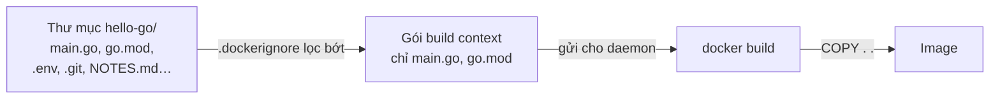
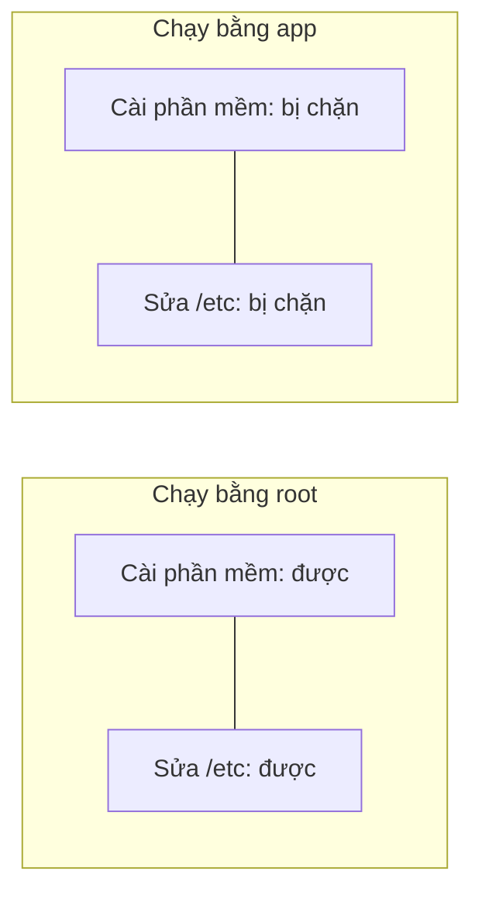

# .dockerignore và user không phải root

Bài trước làm image **nhỏ**. Bài này làm image **sạch và an toàn**: không chứa file không nên có, và không chạy bằng quyền cao nhất.

## 1. Build context được gửi đi thế nào

Nhớ lại chương 2: dấu `.` trong `docker build -t … .` là **build context**. Bản chất là: trước khi build, lệnh `docker` **gói toàn bộ thư mục đó** gửi cho Docker daemon (chương 1). `COPY` chỉ lấy được file trong gói này.



Không lọc thì cả `.git` (có thể vài trăm MB), thư mục `node_modules`, file mật khẩu `.env`… đều bị gói và gửi đi. Gặp `COPY . .` là chúng vào luôn image.

## 2. Thử: một file bí mật lọt vào image

Trong thư mục `hello-go`, tạo hai file giả lập thứ hay có trong một dự án thật:

```bash
echo "DB_PASSWORD=bi-mat" > .env
echo "# Ghi chú" > NOTES.md
```

**Đọc hiểu:** `echo "…" > tên-file` ghi một dòng chữ vào file (tạo mới nếu chưa có). `.env` giả làm file mật khẩu (chương 6 dùng thật). Ở bài này lệnh chạy được cả trên PowerShell lẫn bash, vì ta chỉ cần file **có mặt**. Nhưng Windows PowerShell 5.1 ghi file theo mã hóa UTF-16, nên với file `.env` mà Compose phải **đọc** (chương 6), hãy tạo bằng VS Code thay vì `echo`.

`Dockerfile.single` ở bài trước dùng `COPY . .`. Build lại rồi xem trong image có gì:

```bash
docker build -f Dockerfile.single -t hello-go:single .
docker run --rm hello-go:single ls -a /src
```

```text
.
..
.env
Dockerfile
Dockerfile.single
NOTES.md
go.mod
main.go
```

**Đọc hiểu:** `ls -a` (*all*) liệt kê cả file ẩn bắt đầu bằng dấu chấm. File `.env` có mật khẩu đã nằm trong image. Ai pull được image này (đồng đội, người trên registry public ở chương 7) là đọc được mật khẩu, kể cả khi bạn xóa `.env` trên máy sau đó.

## 3. .dockerignore

**`.dockerignore`** (*danh sách Docker bỏ qua*) là file đặt cạnh `Dockerfile`, liệt kê những gì **không** đưa vào build context. Cú pháp **gần giống** `.gitignore`: mỗi dòng một mẫu tên. Khác một điểm quan trọng: mẫu trong `.dockerignore` tính **từ gốc build context**. `.env` chỉ bỏ file `.env` ở thư mục gốc, còn `sub/.env` vẫn lọt vào; trong `.gitignore` thì `.env` bỏ ở mọi cấp. Muốn bỏ ở mọi thư mục con, viết `**/` phía trước (`**` nghĩa là "bất kỳ bao nhiêu thư mục", kể cả không có).

Tạo `hello-go/.dockerignore`:

```text
.git
**/.env
**/*.md
Dockerfile*
.dockerignore
```

**Đọc hiểu:**

| Dòng | Bỏ qua | Vì sao |
| --- | --- | --- |
| `.git` | lịch sử Git | to, và có thể chứa mật khẩu từng lỡ commit |
| `**/.env` | file `.env` ở **mọi** thư mục | file mật khẩu **không bao giờ** được vào image |
| `**/*.md` | mọi file đuôi `.md` ở mọi thư mục (README, ghi chú) | không cần để chạy. `*` nghĩa là "bất kỳ chuỗi nào" |
| `Dockerfile*` | `Dockerfile`, `Dockerfile.single` | không cần trong image |
| `.dockerignore` | chính nó | không cần trong image |

Build lại và kiểm tra:

```bash
docker build -f Dockerfile.single -t hello-go:single .
docker run --rm hello-go:single ls -a /src
```

```text
.
..
go.mod
main.go
```

Sạch. Ba lợi ích của `.dockerignore`:

1. **An toàn**: file bí mật không lọt vào image.
2. **Build nhanh hơn**: gói build context nhỏ, gửi đi nhanh.
3. **Cache ổn định hơn**: sửa `README.md` không còn làm `COPY . .` chạy lại (chương 2).

Với trang web ở chương 2, `COPY site/ …` đã an toàn sẵn vì chỉ chép thư mục `site/`. Nhưng vẫn nên có `.dockerignore` bỏ `.git` và `.env`: phòng khi có người đổi thành `COPY . …`, và để build context nhỏ.

## 4. root: quyền cao nhất

Trên Linux, **root** (*gốc*) là tài khoản quản trị, làm được **mọi thứ**: cài phần mềm, sửa file hệ thống, đọc file của mọi người. **Mặc định, tiến trình trong container chạy bằng root.**

```bash
docker run --rm hello-go:single whoami
```

```text
root
```

**Đọc hiểu:** `whoami` = *who am I*, "tôi là ai": in tên user đang chạy lệnh.

Vì sao đáng lo? Container cách ly với máy bạn, nhưng không tuyệt đối (bài 1 chương 1: cách ly yếu hơn máy ảo). Giả sử ứng dụng của bạn có lỗi bảo mật và kẻ xấu chạy được lệnh trong container:

- Chạy bằng root: họ cài thêm công cụ, sửa file hệ thống, và nếu có thêm một lỗi cách ly nữa thì có thể thoát ra máy chủ với quyền cao.
- Chạy bằng user thường: họ bị chặn ở hầu hết các bước đó.

Tổng những chỗ kẻ xấu có thể lợi dụng gọi là **attack surface** (*bề mặt tấn công*). Bớt quyền, bớt phần mềm thừa (bài trước) là thu nhỏ bề mặt đó.

## 5. USER: chạy bằng user thường

Dockerfile multi-stage ở bài trước đã có sẵn hai dòng:

```dockerfile
RUN adduser -D -u 10001 app
USER app
```

**Đọc hiểu:**

- `adduser` (lệnh của Alpine) tạo user tên `app`. `-D` = *don't assign a password*, không đặt mật khẩu (không ai cần đăng nhập). `-u 10001` đặt số hiệu user là 10001, một số lớn để không trùng user nào của máy chủ.
- `USER app` (*người dùng*): từ dòng này trở đi, mọi lệnh, và cả tiến trình khi container chạy, dùng user `app`.
- Thứ tự quan trọng: `adduser` cần quyền root, nên phải đứng **trước** `USER app`.

Kiểm tra:

```bash
docker run -d --name hello -p 8080:8080 hello-go:multi
docker exec hello whoami
docker exec hello apk add curl
docker rm -f hello
```

```text
app
ERROR: Unable to lock database: Permission denied
```

**Đọc hiểu:** `whoami` in `app`. `apk add curl` (cài phần mềm trên Alpine) bị từ chối vì user thường không có quyền: đúng điều ta muốn. Ứng dụng vẫn chạy bình thường vì nó chỉ cần nghe cổng 8080 và trả lời.



Một lưu ý: user thường không được nghe các cổng **dưới 1024** trong một số cấu hình. Vì vậy ứng dụng chạy bằng user thường hay nghe cổng như 8080, 3000. Image `nginx` chính thức vẫn khởi động bằng root để nghe cổng 80 (rồi tự hạ quyền cho các tiến trình con), nên trang web ở chương 2 cứ để nguyên.

## 6. Sai lầm thường gặp

| Sai lầm | Hậu quả | Đúng |
| --- | --- | --- |
| Không có `.dockerignore`, dùng `COPY . .` | `.env`, `.git` lọt vào image | Luôn có `.dockerignore` |
| Nghĩ "xóa `.env` ở bước sau trong Dockerfile là xong" | File vẫn nằm trong layer cũ, ai cũng lấy ra được | Không để nó vào build context từ đầu |
| Đặt `USER app` trước `RUN adduser` | `unable to find user app` | Tạo user trước, `USER` sau |
| Đặt `USER app` rồi `RUN apk add …` | `Permission denied` lúc build | Cài phần mềm trước, `USER` ở gần cuối |

## 7. Ngoài thực tế

Ở nhiều công ty, có quy định bắt buộc: image không được chạy bằng root, và CI tự quét image tìm mật khẩu bị lọt (công cụ như gitleaks, trufflehog, Trivy). Một mật khẩu đã lọt vào image trên registry phải coi là **đã lộ**: đổi mật khẩu ngay, xóa image không đủ, vì có thể ai đó đã pull về.

Khi làm nhóm, `.dockerignore` được commit cùng `Dockerfile` và review như code. Người review thường hỏi: "file `.env` có nằm trong `.dockerignore` và `.gitignore` chưa?".

## 8. Khi bị lỗi

| Lỗi | Vì sao | Cách sửa |
| --- | --- | --- |
| `COPY` báo `not found` sau khi thêm `.dockerignore` | Bạn lỡ bỏ qua chính file cần chép | Xem lại các mẫu, nhất là mẫu có `*` |
| `unable to find user app` | `USER app` đứng trước `adduser` | Đổi thứ tự |
| `Permission denied` khi app ghi file | User `app` không có quyền ghi thư mục đó | Ghi vào thư mục của user (như `/tmp`), hoặc dùng volume (chương 4) |
| Lỗi khác, hoặc chưa hiểu vì sao | | Nhắn mentor, công khai hay **nhắn riêng** đều được (tab **Cài đặt** → "Hỏi ở đâu") |

## Tóm tắt

- Build context là cả thư mục được gói gửi cho Docker; `.dockerignore` lọc bớt nó.
- Luôn bỏ `.git` và `.env` khỏi build context.
- Mặc định container chạy bằng root; `RUN adduser …` + `USER app` để chạy bằng user thường.
- Ít quyền, ít phần mềm thừa = bề mặt tấn công nhỏ.
