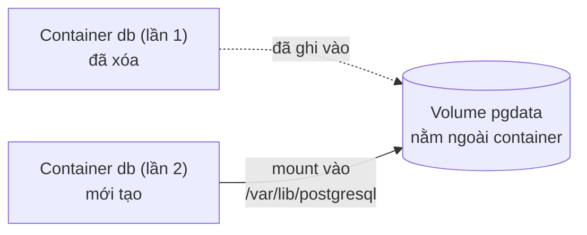

# Volume: dữ liệu sống sót khi xóa container

Trang web tĩnh xóa container rồi chạy lại vẫn y nguyên, vì mọi thứ nằm trong image. **Database** thì khác: dữ liệu sinh ra **trong lúc chạy** (người dùng đăng ký, bài viết mới…). Chương 5 dùng Postgres để lưu số liệu truy cập; mất dữ liệu mỗi lần tạo lại container là không chấp nhận được.

Bài này dùng **Postgres** (PostgreSQL), một database phổ biến, qua image `postgres:18-alpine`.

## 1. Vì sao dữ liệu mất: nhớ lại lớp ghi

Chương 2: mỗi container có một **lớp ghi** mỏng nằm trên các layer chỉ đọc của image. Postgres ghi dữ liệu vào ổ đĩa, tức là ghi vào lớp ghi đó. `docker rm` bỏ lớp ghi đi, **dữ liệu đi theo**.

## 2. Thử: không có volume

```bash
docker run -d --name db -e POSTGRES_PASSWORD=matkhau postgres:18-alpine
```

**Đọc hiểu:**

- Image `postgres` **bắt buộc** có biến môi trường `POSTGRES_PASSWORD` (chương 1, `-e`): mật khẩu của tài khoản quản trị `postgres`. Thiếu thì container dừng ngay, `docker logs db` báo `Database is uninitialized and superuser password is not specified`.
- Không có `-p`: ta chỉ làm việc với Postgres qua `docker exec`, không cần mở cổng ra máy.

Chờ khoảng 5 giây cho Postgres khởi động, rồi tạo bảng và thêm một dòng:

```bash
docker exec db psql -U postgres -c "CREATE TABLE notes (id serial PRIMARY KEY, body text); INSERT INTO notes (body) VALUES ('Xin chao Docker');"
```

```text
CREATE TABLE
INSERT 0 1
```

**Đọc hiểu:** `psql` là công cụ dòng lệnh của Postgres, có sẵn trong image. `-U postgres` = *user* postgres. `-c "…"` = *command*, chạy câu SQL trong ngoặc: tạo bảng `notes` có hai cột (`id` tự tăng, `body` là chữ), rồi thêm một dòng. Không cần biết SQL, chỉ cần biết đây là "ghi dữ liệu".

Xóa container, chạy lại y hệt, tìm dữ liệu:

```bash
docker rm -f db
docker run -d --name db -e POSTGRES_PASSWORD=matkhau postgres:18-alpine
docker exec db psql -U postgres -c "SELECT * FROM notes;"
```

```text
ERROR:  relation "notes" does not exist
```

**Mất.** Bảng `notes` nằm trong lớp ghi của container cũ, bị xóa cùng nó. (Gặp `the database system is starting up` thì chờ vài giây rồi chạy lại lệnh `exec`.)

## 3. Volume: ổ đĩa rời cắm vào container

**Volume** là một vùng lưu trữ do Docker quản lý, nằm **ngoài** container. Ví von: một **ổ cứng rời** (USB). Bạn **mount** (*gắn*, như cắm USB) nó vào một thư mục trong container; mọi thứ ghi vào thư mục đó thật ra ghi lên ổ rời. Vứt container đi, ổ rời vẫn còn, cắm vào container mới là có lại dữ liệu.




| | Lớp ghi của container | Volume |
| --- | --- | --- |
| Nằm ở đâu | Trong container | Ngoài container, Docker quản lý |
| Xóa container thì | **Mất** | **Còn** |
| Dùng cho | File tạm, log | Dữ liệu cần **persist** (*tồn tại lâu dài*): database, file người dùng tải lên |

## 4. Làm lại với named volume

```bash
docker rm -f db
docker volume create pgdata
docker run -d --name db -e POSTGRES_PASSWORD=matkhau -v pgdata:/var/lib/postgresql postgres:18-alpine
```

**Đọc hiểu:**

- `docker volume create pgdata`: tạo một **named volume** (*volume có tên*) tên `pgdata`. (Bỏ bước này cũng được: `-v` tự tạo nếu chưa có. Tách ra cho rõ.)
- `-v pgdata:/var/lib/postgresql`: `-v` = *volume*, mount volume `pgdata` vào thư mục `/var/lib/postgresql` trong container. Dạng chung: `-v tên-volume:đường-dẫn-trong-container`.
- Vì sao thư mục đó? Đó là nơi Postgres 18 lưu dữ liệu. Mỗi image ghi rõ thư mục dữ liệu trên trang Docker Hub của nó. (Postgres 17 trở về trước dùng `/var/lib/postgresql/data`.)

Làm lại thí nghiệm (chờ 5 giây sau lệnh `run` rồi mới `exec`):

```bash
docker exec db psql -U postgres -c "CREATE TABLE notes (id serial PRIMARY KEY, body text); INSERT INTO notes (body) VALUES ('Xin chao Docker');"
docker rm -f db
docker run -d --name db -e POSTGRES_PASSWORD=matkhau -v pgdata:/var/lib/postgresql postgres:18-alpine
docker exec db psql -U postgres -c "SELECT * FROM notes;"
```

```text
 id |      body
----+-----------------
  1 | Xin chao Docker
(1 row)
```

**Còn nguyên.** Container `db` thứ hai là container mới hoàn toàn, nhưng nó cắm lại đúng ổ `pgdata`.

## 5. Quản lý volume

```bash
docker volume ls
docker volume inspect pgdata
```

**Đọc hiểu:** `ls` liệt kê volume. `inspect` (*xem xét*) in chi tiết, trong đó `Mountpoint` là chỗ Docker cất dữ liệu bên trong máy Linux của Docker Desktop. Bạn không cần đụng vào đó.

Xóa volume (**chưa làm bây giờ**, bài sau dùng tiếp):

```bash
docker volume rm pgdata
```

`docker volume rm` xóa **vĩnh viễn**. Volume đang được container dùng thì không xóa được; xóa container trước. Với database thật, sao lưu trước (ví dụ bằng `pg_dump`).

**Một điều hay gây lỗi:** Postgres chỉ đặt mật khẩu **lần đầu** nó khởi tạo một volume trống. Volume đã có dữ liệu thì Postgres bỏ qua `POSTGRES_PASSWORD`. Đổi mật khẩu trong lệnh `run` mà dùng lại volume cũ thì mật khẩu **vẫn là mật khẩu cũ**. Chương 6 gặp lại lỗi này.

## 6. Bind mount: gắn thẳng thư mục trên máy bạn

`-v` còn nhận **đường dẫn trên máy bạn** thay cho tên volume. Kiểu này gọi là **bind mount** (*gắn trói*). Ví dụ, đứng trong thư mục `my-site` của chương 2:

```bash
docker run -d --name live -p 8082:80 -v ./site:/usr/share/nginx/html nginx:1.30-alpine
```

**Đọc hiểu:** thư mục `site/` trên máy bạn được gắn thẳng vào thư mục nginx phục vụ. Mở <http://localhost:8082>: trang của bạn, **không cần build image**. Sửa `site/index.html` rồi tải lại trình duyệt: thấy ngay. Dọn: `docker rm -f live`.

| | Named volume | Bind mount |
| --- | --- | --- |
| Viết | `-v pgdata:/đường/dẫn` | `-v ./site:/đường/dẫn` (có `/` hoặc `./`) |
| Dữ liệu ở đâu | Docker quản lý, bạn không cần biết | Thư mục bạn chọn trên máy |
| Hợp cho | Database, dữ liệu của ứng dụng | Đang phát triển, muốn sửa file thấy ngay |
| Rủi ro | Ít | Phụ thuộc đường dẫn và quyền file trên Windows/macOS; container ghi được thẳng vào máy bạn |

Track này dùng **named volume cho database**, và bind mount chỉ để thử.

## 7. Sai lầm thường gặp

| Sai lầm | Hậu quả | Đúng |
| --- | --- | --- |
| Chạy database không có volume | Mất hết dữ liệu khi tạo lại container | Luôn `-v tên:thư-mục-dữ-liệu` |
| Gắn volume sai thư mục (ví dụ `/data`) | Postgres vẫn ghi vào chỗ cũ, volume rỗng, dữ liệu vẫn mất | Xem trang image để biết thư mục dữ liệu |
| Nghĩ `docker rm` xóa luôn volume | Volume còn, chiếm ổ đĩa | `docker volume ls` và dọn khi chắc chắn |
| Đổi `POSTGRES_PASSWORD` với volume cũ | Sai mật khẩu | Dùng mật khẩu cũ, hoặc xóa volume (mất dữ liệu) |

## 8. Ngoài thực tế

Ở công ty, database thật thường **không** chạy trong container trên laptop, mà là dịch vụ có người quản lý (máy chủ riêng, hoặc dịch vụ cloud), có sao lưu tự động. Container Postgres với volume là cách **mỗi lập trình viên có một database riêng trên máy** để code và test, giống hệt phiên bản trên máy chủ.

Quy tắc chung của nhóm: **không lưu dữ liệu quan trọng trong lớp ghi của container**. Container được coi là đồ dùng xong vứt (chương 1); dữ liệu phải nằm ở volume hoặc ở dịch vụ bên ngoài.

## 9. Khi bị lỗi

| Lỗi | Vì sao | Cách sửa |
| --- | --- | --- |
| `Database is uninitialized and superuser password is not specified` | Thiếu `-e POSTGRES_PASSWORD=…` | Thêm vào lệnh `run` |
| `the database system is starting up` | Postgres chưa khởi động xong | Chờ vài giây, chạy lại |
| `relation "notes" does not exist` sau khi đã có volume | Gắn sai thư mục, hoặc gõ sai tên volume (tạo ra volume mới rỗng) | So với lệnh trong bài; `docker volume ls` |
| `volume is in use` khi xóa volume | Còn container dùng nó | `docker rm -f db` trước |
| Lỗi khác, hoặc chưa hiểu vì sao | | Nhắn mentor, công khai hay **nhắn riêng** đều được (tab **Cài đặt** → "Hỏi ở đâu") |

## Tóm tắt

- Dữ liệu ghi trong container nằm ở lớp ghi, mất khi xóa container.
- Volume là "ổ rời" ngoài container: `-v tên-volume:/thư-mục`. Postgres 18 dùng `/var/lib/postgresql`.
- Bind mount gắn thư mục trên máy bạn: tiện khi đang phát triển.
- Mật khẩu Postgres chỉ được đặt lần đầu khởi tạo volume.

Chưa dọn vội: bài sau dùng tiếp container `db` và volume `pgdata`.
