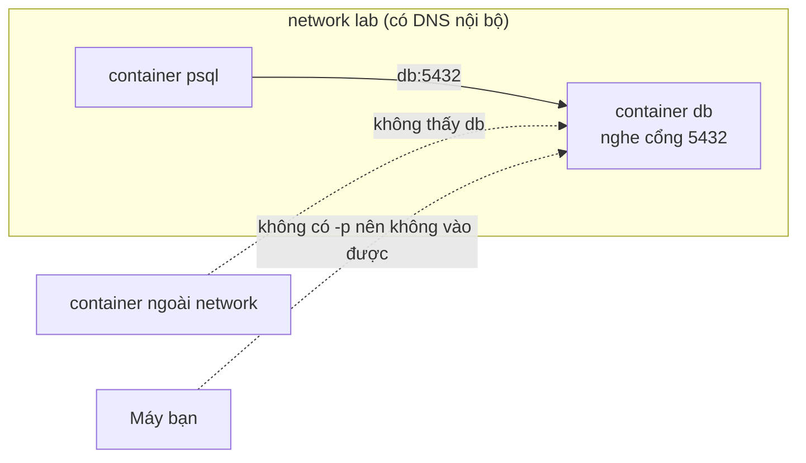

# Network: container gọi nhau bằng tên

Một ứng dụng thật thường có nhiều phần: web, backend, database. Mỗi phần một container. Chúng phải nói chuyện với nhau. Câu hỏi: container `umami` (chương 5) tìm container `db` bằng cách nào?

## 1. Bản chất: mỗi container có một địa chỉ IP, nhưng IP hay đổi

Mỗi container được gắn vào một **network** (*mạng*) ảo do Docker tạo, và nhận một địa chỉ IP trong mạng đó, ví dụ `172.26.0.2`. Container khác gọi tới IP đó là nói chuyện được.

Vấn đề: IP do Docker cấp **mỗi lần một khác**. Xóa container `db` rồi tạo lại, nó có thể nhận IP mới. Ghi cứng IP vào cấu hình thì hôm nay chạy, mai hỏng.

Giải pháp giống ngoài đời: ta không nhớ số điện thoại của bạn bè, ta lưu **tên** trong danh bạ. **DNS** (*Domain Name System*, hệ thống tên miền) là "danh bạ" của mạng: hỏi tên, nó trả về IP. Trên mỗi network **do bạn tạo**, Docker có sẵn một DNS nội bộ: **tên container chính là tên máy**.

## 2. Tạo network và gọi bằng tên

Bài trước để lại container `db` và volume `pgdata`. Tạo lại `db` trên một network mới:

```bash
docker rm -f db
docker network create lab
docker run -d --name db --network lab -e POSTGRES_PASSWORD=matkhau -v pgdata:/var/lib/postgresql postgres:18-alpine
```

**Đọc hiểu:**

- `docker network create lab`: tạo network tên `lab`.
- `--network lab`: gắn container `db` vào network `lab`. Từ giờ, trong `lab`, cái tên `db` trỏ tới container này.
- Vẫn dùng volume `pgdata`, nên bảng `notes` từ bài trước còn nguyên.

Chạy **một container khác** trên cùng network, dùng `psql` kết nối tới máy tên `db`:

```bash
docker run --rm --network lab -e PGPASSWORD=matkhau postgres:18-alpine psql -h db -U postgres -c "SELECT count(*) FROM notes;"
```

```text
 count
-------
     1
(1 row)
```

**Đọc hiểu:**

- Đây là container **thứ hai**, chỉ dùng một lần (`--rm`), cũng trên network `lab`.
- `-h db` = *host* (máy) tên `db`. DNS nội bộ đổi `db` thành IP của container `db`.
- `-e PGPASSWORD=matkhau`: `psql` đọc mật khẩu từ biến này để khỏi hỏi.
- Kết quả `1`: đếm được một dòng, chính là dòng `Xin chao Docker` của bài trước.

Xem DNS trả lời gì (dùng image `alpine` nhỏ, lệnh `getent hosts` hỏi địa chỉ của một tên):

```bash
docker run --rm --network lab alpine:3.22 getent hosts db
```

```text
172.26.0.2        db  db
```

Con số IP của bạn có thể khác. Đó chính là lý do ta dùng tên.

## 3. Container ngoài network thì không thấy

Thử từ một container **không** gắn vào `lab`:

```bash
docker run --rm alpine:3.22 sh -c 'getent hosts db || echo "khong tim thay db"'
```

```text
khong tim thay db
```

**Đọc hiểu:** không có `--network lab` thì container vào network mặc định của Docker, nơi không có ai tên `db`. `||` nghĩa là "nếu lệnh trước thất bại thì chạy lệnh sau". Container chỉ thấy nhau khi **cùng network**.




## 4. -p chỉ dành cho máy bạn

Để ý: container `db` **không có** `-p`, vậy mà container `psql` vẫn kết nối được tới cổng 5432. Giữa các container **cùng network**, mọi cổng đều thông. `-p` (chương 1) chỉ cần khi **máy bạn** (trình duyệt, công cụ trên máy) muốn vào container.

| Ai gọi | Gọi tới đâu | Cần `-p`? |
| --- | --- | --- |
| Trình duyệt trên máy bạn | `localhost:8080` | Có: `-p 8080:80` |
| Container khác cùng network | `db:5432` | Không |
| Container khác network | | Không gọi được |

Không mở cổng database ra ngoài khi không cần là một thói quen an toàn: càng ít cổng mở, càng ít chỗ bị tấn công.

## 5. localhost trong container là chính nó

**localhost** (*máy cục bộ*) nghĩa là "chính máy đang gọi". Trên máy bạn, `localhost` là máy bạn. **Trong một container, `localhost` là chính container đó**, không phải máy bạn, cũng không phải container khác.

| Đứng ở đâu | `localhost` là |
| --- | --- |
| Trình duyệt trên máy bạn | máy bạn (nên `localhost:8080` đi qua `-p` vào container) |
| Bên trong container `umami` | chính container `umami` |
| Bên trong container `db` | chính container `db` |

Vì vậy, nếu cấu hình Umami (chương 5) kết nối `localhost:5432`, nó sẽ gõ cửa **chính nó**, nơi không có Postgres nào, và báo lỗi. Đúng phải là `db:5432`.

## 6. Dọn dẹp

```bash
docker rm -f db
docker network rm lab
docker volume rm pgdata
```

**Đọc hiểu:** xóa container trước, rồi network, rồi volume. Network hay volume còn container dùng thì không xóa được.

## 7. Sắp tới: Compose làm hết việc này

Đếm lại: `network create`, `volume create`, `run` với một dãy `--network`, `-v`, `-e`, đúng thứ tự… Rất dễ gõ sai. Chương 5 viết tất cả vào **một file** `compose.yaml`. Docker Compose tự tạo một network chung cho mọi service, và **tên service chính là tên máy**, đúng như bài này.

## 8. Sai lầm thường gặp

| Sai lầm | Hậu quả | Đúng |
| --- | --- | --- |
| Ghi cứng IP `172.x.x.x` vào cấu hình | Hỏng khi container được tạo lại | Dùng tên container |
| Dùng `localhost` để gọi container khác | `Connection refused` | Dùng tên container, ví dụ `db` |
| Quên `--network` ở một container | Không tìm thấy tên | Mọi container cần nói chuyện phải cùng network |
| Thêm `-p 5432:5432` cho database "cho chắc" | Mở database ra ngoài không cần thiết | Chỉ `-p` khi máy bạn cần vào |

## 9. Ngoài thực tế

Ở công ty, một hệ thống có thể có hàng chục container, chia nhiều network: network "frontend" cho web và proxy, network "backend" cho API và database. Database chỉ nằm ở network backend, nên dù web bị tấn công, kẻ xấu cũng không gọi thẳng được database. Cấu hình kết nối luôn dùng **tên** (`db`, `redis`, `api`), không bao giờ dùng IP, để hệ thống chạy được ở mọi máy.

## 10. Khi bị lỗi

| Lỗi | Vì sao | Cách sửa |
| --- | --- | --- |
| `could not translate host name "db"` | Hai container không cùng network, hoặc `db` chưa chạy | Kiểm tra `--network lab` ở cả hai; `docker ps` |
| `Connection refused` | Gọi `localhost` từ trong container, hoặc sai cổng | Dùng tên container và cổng ứng dụng nghe (Postgres: 5432) |
| `network lab not found` | Chưa tạo network | `docker network create lab` |
| `network has active endpoints` khi xóa network | Còn container gắn vào | `docker rm -f` container trước |
| Lỗi khác, hoặc chưa hiểu vì sao | | Nhắn mentor, công khai hay **nhắn riêng** đều được (tab **Cài đặt** → "Hỏi ở đâu") |

## Tóm tắt

- Container trên cùng một network do bạn tạo gọi nhau bằng tên, nhờ DNS nội bộ của Docker.
- Giữa các container cùng network, cổng thông sẵn; `-p` chỉ để máy bạn vào.
- Trong container, `localhost` là chính nó.
