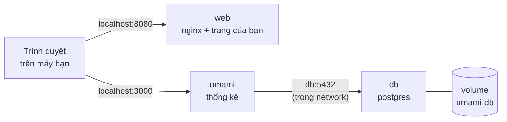
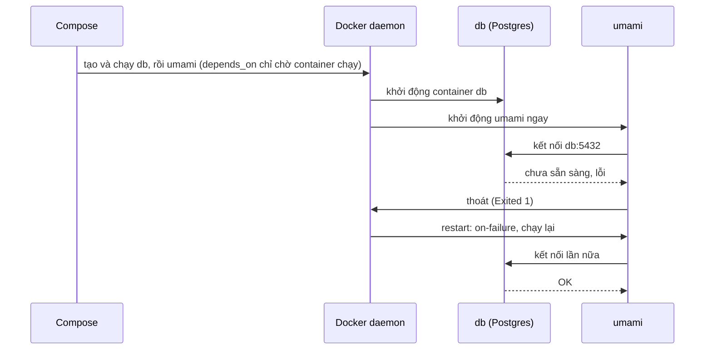

# Trang web + Umami + Postgres

[**Umami**](https://umami.is) là công cụ thống kê lượt xem trang web, mã nguồn mở, gọn nhẹ. Nó chạy bằng image có sẵn và lưu dữ liệu vào Postgres. Bạn không viết dòng code backend nào, mà vẫn có một hệ thống **ba container** thật sự, giống cấu trúc của rất nhiều ứng dụng: web, ứng dụng, database.



**Đọc hiểu sơ đồ:** trình duyệt vào được `web` và `umami` nhờ `ports` (như `-p`). `umami` gọi `db` bằng **tên service** qua network nội bộ (chương 4). `db` không mở cổng ra máy bạn. Dữ liệu của `db` nằm trong volume `umami-db`.

## 1. compose.yaml ba service

Thay nội dung `my-site/compose.yaml`:

```yaml
services:
  web:
    build: .
    ports:
      - "8080:80"

  umami:
    image: ghcr.io/umami-software/umami:3.5.0
    ports:
      - "3000:3000"
    environment:
      DATABASE_URL: postgresql://umami:matkhau-hoc-tap@db:5432/umami
      APP_SECRET: chuoi-bi-mat-de-hoc
    depends_on:
      - db
    restart: on-failure

  db:
    image: postgres:18-alpine
    environment:
      POSTGRES_DB: umami
      POSTGRES_USER: umami
      POSTGRES_PASSWORD: matkhau-hoc-tap
    volumes:
      - umami-db:/var/lib/postgresql

volumes:
  umami-db:
```

**Mật khẩu đang nằm thẳng trong file.** Chấp nhận được **chỉ để học trên máy**, với mật khẩu giả. Chương 6 chuyển chúng ra file `.env` nằm ngoài Git. Đừng commit file này với mật khẩu thật.

## 2. Đọc hiểu từng service

**`web`** giữ nguyên như bài trước.

**`umami`:**

- `image: ghcr.io/umami-software/umami:3.5.0`: image có sẵn trên registry GHCR (chương 7), tag phiên bản cụ thể.
- `ports: "3000:3000"`: Umami nghe cổng 3000 bên trong; mở ra cổng 3000 trên máy bạn.
- `environment`: như nhiều `-e` (chương 1). Umami đọc hai biến:
  - `DATABASE_URL`: địa chỉ database, dạng `postgresql://<user>:<mật khẩu>@<máy>:<cổng>/<tên database>`. **Máy là `db`**: tên service, đúng như `-h db` ở chương 4. Không phải `localhost` (chương 4, mục 5).
  - `APP_SECRET`: chuỗi bí mật Umami dùng để ký phiên đăng nhập.
- `depends_on: [db]` (*phụ thuộc vào*): khởi động `db` **trước** `umami`. Mục 4 nói giới hạn của nó.
- `restart: on-failure`: một **restart policy** (*chính sách khởi động lại*): nếu container thoát vì lỗi, Docker tự chạy lại nó. Mục 4 giải thích vì sao cần.

**`db`:**

- `POSTGRES_DB`, `POSTGRES_USER`, `POSTGRES_PASSWORD`: lần đầu khởi tạo, Postgres tạo database `umami` và user `umami` với mật khẩu này. Phải **khớp** với `DATABASE_URL` của Umami.
- **Không có `ports`**: chỉ Umami cần nói chuyện với Postgres, qua network nội bộ.
- `volumes: - umami-db:/var/lib/postgresql`: gắn named volume vào thư mục dữ liệu, như `-v` ở chương 4.

**`volumes:` ở cuối file** (cùng cấp với `services`) khai báo named volume `umami-db`. Compose tự tạo nó, tên thật là `my-site_umami-db`.

## 3. Chạy

```bash
docker compose up -d
```

Lần đầu mất một lúc để tải image Umami và Postgres. Chờ khoảng 30 giây rồi:

```bash
docker compose ps
```

```text
NAME              IMAGE                                SERVICE   STATUS          PORTS
my-site-db-1      postgres:18-alpine                   db        Up 25 seconds   5432/tcp
my-site-umami-1   ghcr.io/umami-software/umami:3.5.0   umami     Up 24 seconds   0.0.0.0:3000->3000/tcp
my-site-web-1     my-site-web                          web       Up 25 seconds   0.0.0.0:8080->80/tcp
```

**Đọc hiểu:** ba container, tên dạng `<project>-<service>-1`. Cột `PORTS` của `db` là `5432/tcp` **không có** mũi tên `->`: cổng chỉ mở trong network, không ra máy bạn. Image của `web` tên `my-site-web` do Compose tự build.

Kiểm tra (Windows: `curl.exe`):

```bash
curl http://localhost:3000/api/heartbeat
```

```text
{"ok":true}
```

`/api/heartbeat` (*nhịp tim*) là đường dẫn Umami dùng để báo "tôi còn sống".

## 4. Thứ tự khởi động: chuyện gì đã xảy ra

Xem log của Umami:

```bash
docker compose logs umami
```

Rất có thể bạn thấy đoạn đầu như sau:

```text
umami-1  | ✓ DATABASE_URL is defined.
umami-1  | Raw query failed. Code: `N/A`. Message: `Can't reach database server at 172.26.0.2:5432`
umami-1  | ✓ DATABASE_URL is defined.
umami-1  | ✓ Database connection successful.
umami-1  | ✓ Database version check successful.
umami-1  | Applying migration `01_init`
```

**Đọc hiểu:** lần chạy đầu tiên Umami **không kết nối được** database, thoát vì lỗi; rồi được chạy lại và lần sau thành công. Vì sao?

`depends_on` dạng ngắn chỉ hứa: "khởi động **container** `db` trước". Nó **không** chờ Postgres **sẵn sàng nhận kết nối**. Postgres cần vài giây (lần đầu còn lâu hơn vì phải khởi tạo database), trong lúc đó Umami đã chạy và gõ cửa sớm.



`restart: on-failure` cứu ta ở đây: Umami thoát vì lỗi thì **Docker daemon** (chương 1), không phải Compose, chạy lại nó. Compose chỉ ghi chính sách đó vào container lúc tạo; sau đó daemon tự canh, kể cả khi bạn đã tắt terminal. Cách này **chạy được, nhưng chưa đẹp**: log đầy lỗi, và nếu database hỏng thật thì Umami cứ lặp mãi. Chương 6 dùng `healthcheck` để Umami **chờ đúng lúc** Postgres sẵn sàng.

## 5. Gọi nhau bằng tên service

Chứng minh tên service là tên máy: từ trong container `web`, gọi Umami:

```bash
docker compose exec web wget -qO- http://umami:3000/api/heartbeat
```

```text
{"ok":true}
```

**Đọc hiểu:** `docker compose exec web …` giống `docker exec` (chương 1) nhưng gọi theo tên service. `wget -qO-` tải một trang và in ra màn hình (`-q` = *quiet*, bớt thông báo; `-O-` = ghi ra màn hình). Từ trong `web`, cái tên `umami` dẫn tới container Umami: Compose đã làm đúng việc `--network` và DNS của chương 4 cho bạn.

## 6. Gắn Umami vào trang web

1. Mở <http://localhost:3000>, đăng nhập tài khoản mặc định `admin` / `umami`. **Đổi mật khẩu ngay** trong phần cài đặt tài khoản (Settings → Profile).
2. Vào **Settings → Websites → Add website**: tên `My site`, domain `localhost`.
3. Mở website vừa tạo, tìm phần **Tracking code** (mã theo dõi). Umami đưa một dòng có dạng như bên dưới. Tên nút có thể khác một chút giữa các phiên bản Umami.
4. Dán dòng đó vào trong `<head>` của `site/index.html`.
5. Build lại web: `docker compose up -d --build`.
6. Mở <http://localhost:8080> vài lần, rồi xem trang thống kê của website trong Umami: số lượt xem tăng.

Mã theo dõi (bước 3) có dạng:

```html
<script defer src="http://localhost:3000/script.js" data-website-id="<id-website-của-bạn>"></script>
```

**Đọc hiểu:** khi ai đó mở trang của bạn, trình duyệt **của họ** tải `script.js` từ Umami, script đó gửi một lượt xem về Umami. Vì địa chỉ là `localhost:3000`, chỉ đếm được khi xem trên **chính máy bạn**. Đưa Umami lên máy chủ thật nằm ngoài phạm vi track này.

## 7. Dừng và dữ liệu

```bash
docker compose down
docker compose up -d
```

**Đọc hiểu:** `down` xóa container và network, **giữ volume** `my-site_umami-db`. `up` lại: đăng nhập vẫn bằng mật khẩu mới, website và lượt xem vẫn còn. Đúng bài học volume của chương 4.

```bash
docker compose down -v
```

`-v` xóa **luôn volume**: mất hết dữ liệu Umami. Chỉ dùng khi muốn làm lại từ đầu.

## 8. Sai lầm thường gặp

| Sai lầm | Hậu quả | Đúng |
| --- | --- | --- |
| `DATABASE_URL` dùng `localhost:5432` | `Can't reach database server` mãi mãi | Dùng tên service `db` |
| Mật khẩu ở `DATABASE_URL` khác `POSTGRES_PASSWORD` | `password authentication failed` | Hai chỗ phải khớp (chương 6 gom về một chỗ) |
| Nghĩ `depends_on` chờ database sẵn sàng | Lỗi lúc có lúc không | Chương 6: `healthcheck` + `condition: service_healthy` |
| Commit file có mật khẩu thật | Mật khẩu lộ trên GitHub | Chương 6: `.env` |
| `down -v` khi chỉ muốn tắt | Mất hết dữ liệu | `down` thôi |

## 9. Ngoài thực tế

Cấu trúc "ứng dụng + database + volume" trong một `compose.yaml` là thứ bạn sẽ gặp ở hầu hết dự án: một API Node/Java/Python thay cho Umami, Postgres hay MySQL làm database, đôi khi thêm Redis. Khi vào nhóm mới, việc đầu tiên thường là đọc `compose.yaml` để biết hệ thống có những phần nào và chúng nói chuyện với nhau qua tên gì.

Trong nhóm, **không ai commit mật khẩu thật** vào `compose.yaml`. Mật khẩu ở đây chỉ để học; chương 6 làm đúng cách.

## 10. Khi bị lỗi

| Lỗi | Vì sao | Cách sửa |
| --- | --- | --- |
| `docker compose ps` thấy `umami` `Restarting` mãi | Umami không kết nối được database: sai tên máy, sai mật khẩu | `docker compose logs umami`; so `DATABASE_URL` với service `db` |
| `password authentication failed for user "umami"` | Mật khẩu đã đổi sau khi volume được tạo (chương 4) | Đặt lại mật khẩu cũ, hoặc `docker compose down -v` rồi `up` |
| `port is already allocated` cho 3000 hoặc 8080 | Chương trình khác đang dùng cổng | Đổi số bên trái trong `ports`, ví dụ `"3001:3000"` |
| Trang Umami trắng hoặc không vào được ngay sau `up` | Umami còn đang khởi tạo database lần đầu | Chờ 30 giây, xem `docker compose logs -f umami` |
| Lỗi khác, hoặc chưa hiểu vì sao | | Nhắn mentor, công khai hay **nhắn riêng** đều được (tab **Cài đặt** → "Hỏi ở đâu") |

## Tóm tắt

- Một `compose.yaml` mô tả ba service; `docker compose up -d` dựng cả hệ thống.
- Service gọi nhau bằng tên service (`db:5432`); database không cần `ports`.
- `depends_on` dạng ngắn chỉ chờ container chạy, không chờ ứng dụng sẵn sàng; `restart: on-failure` chạy lại khi lỗi.
- `down` giữ volume, `down -v` xóa volume.
