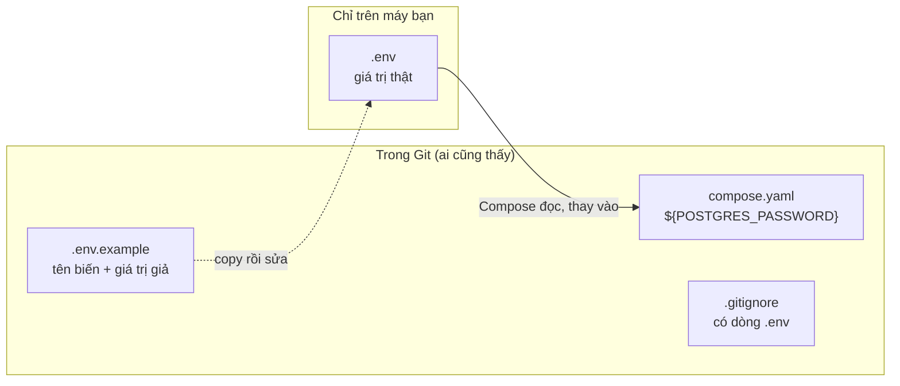

# Mật khẩu ra .env, ngoài Git

`compose.yaml` của chương 5 có mật khẩu nằm thẳng trong file. File đó sẽ được commit lên GitHub, và repo của bạn là public. Một mật khẩu thật nằm ở đó là **lộ cho cả thế giới**: có những con bot chuyên quét GitHub tìm mật khẩu, tính bằng phút.

Nguyên tắc: **cấu hình (không bí mật) nằm trong Git; bí mật nằm ngoài Git.**

## 1. Hai chỗ, hai vai



| File | Chứa | Commit? |
| --- | --- | --- |
| `compose.yaml` | cấu trúc hệ thống, **chỗ trống** `${…}` cho bí mật | Có |
| `.env` | giá trị thật: mật khẩu, khóa bí mật | **Không bao giờ** |
| `.env.example` | tên biến, giá trị giả, chú thích | Có |
| `.gitignore` | dòng `.env` để Git bỏ qua nó | Có |

## 2. Tạo .env

Ở thư mục `my-site`, tạo file `.env` (tên bắt đầu bằng dấu chấm, không có gì phía trước) bằng VS Code:

```text
POSTGRES_PASSWORD=doi-mat-khau-nay
APP_SECRET=doi-chuoi-ngau-nhien-nay
```

**Đọc hiểu:** mỗi dòng một cặp `TÊN=giá trị`, **không** có dấu cách quanh dấu `=`, không cần nháy. Đổi hai giá trị thành chuỗi dài, khó đoán của riêng bạn.

Tạo bằng trình soạn thảo, đừng bằng `echo … > .env` trong Windows PowerShell 5.1: nó ghi file theo mã hóa UTF-16, Compose đọc không được.

## 3. Thay mật khẩu trong compose.yaml bằng chỗ trống

```yaml
services:
  web:
    build: .
    ports:
      - "${WEB_PORT:-8080}:80"

  umami:
    image: ghcr.io/umami-software/umami:3.5.0
    ports:
      - "3000:3000"
    env_file: .env
    environment:
      DATABASE_URL: postgresql://umami:${POSTGRES_PASSWORD}@db:5432/umami
    depends_on:
      - db
    restart: on-failure

  db:
    image: postgres:18-alpine
    environment:
      POSTGRES_DB: umami
      POSTGRES_USER: umami
      POSTGRES_PASSWORD: ${POSTGRES_PASSWORD}
    volumes:
      - umami-db:/var/lib/postgresql

volumes:
  umami-db:
```

**Đọc hiểu:** có hai cơ chế khác nhau, dễ nhầm:

| Cơ chế | Viết | Xảy ra ở đâu, lúc nào | Dùng khi |
| --- | --- | --- | --- |
| **Variable substitution** (*thay thế biến*) | `${POSTGRES_PASSWORD}` trong `compose.yaml` | Compose đọc `.env` cạnh `compose.yaml` và **thay chữ** trong file, **trước khi** tạo container | Cần ghép giá trị vào chuỗi, như `DATABASE_URL`, hoặc dùng ở chỗ không phải biến môi trường, như `ports` |
| **`env_file: .env`** | khóa trong service | Đưa **mọi dòng** của `.env` vào **bên trong** container, như nhiều `-e` | Container cần đọc nhiều biến; ở đây Umami đọc `APP_SECRET` theo cách này |

- `${WEB_PORT:-8080}`: dùng `WEB_PORT` nếu có, **không có thì mặc định `8080`** (`:-` nghĩa là "nếu trống thì dùng"). Ai bị trùng cổng 8080 chỉ cần thêm `WEB_PORT=8081` vào `.env` của mình, không phải sửa `compose.yaml` chung của cả nhóm.
- Mật khẩu giờ chỉ viết **một lần** trong `.env`, cả `db` và `umami` cùng dùng. Hết lỗi "hai chỗ không khớp" của chương 5.

## 4. Kiểm tra: docker compose config

Muốn biết Compose thật sự hiểu file thế nào sau khi thay biến:

```bash
docker compose config
```

**Đọc hiểu:** `config` in ra `compose.yaml` **sau khi** đã thay mọi `${…}` bằng giá trị thật, và báo lỗi nếu file sai cú pháp. Không chạy container nào. Bạn sẽ thấy `DATABASE_URL: postgresql://umami:doi-mat-khau-nay@db:5432/umami` và `published: "8080"`. Đây là công cụ gỡ lỗi số một cho chuyện biến môi trường (bài 3).

Vì output có mật khẩu thật, **đừng dán nó lên Discord** mà không che.

## 5. Bắt đầu lại sạch sẽ

Volume `my-site_umami-db` của chương 5 đã được khởi tạo với mật khẩu cũ `matkhau-hoc-tap`. Postgres chỉ đặt mật khẩu lần đầu (chương 4), nên với mật khẩu mới trong `.env`, Umami sẽ bị từ chối. Xóa dữ liệu thử nghiệm và chạy lại:

```bash
docker compose down -v
docker compose up -d
```

(Bài 3 sẽ cố tình tạo lại lỗi này để bạn nhận ra nó.)

## 6. Giữ .env ngoài Git

Tạo (hoặc sửa) file `.gitignore` ở gốc repo, thêm dòng:

```text
.env
```

Rồi tạo `.env.example` và **commit file này**:

```text
# Copy file này thành .env rồi đổi giá trị. KHÔNG commit .env.
POSTGRES_PASSWORD=doi-mat-khau-nay
APP_SECRET=doi-chuoi-ngau-nhien-nay
# Tuỳ chọn: đổi cổng trang web nếu 8080 đã bị dùng
# WEB_PORT=8081
```

Kiểm tra trước khi commit:

```bash
git status
```

**Đọc hiểu:** danh sách file thay đổi **không được** có `.env`. Có `compose.yaml`, `.env.example`, `.gitignore` là đúng. Người khác clone repo về chỉ cần:

```bash
cp .env.example .env
```

rồi sửa giá trị. (`cp` = *copy*. Windows PowerShell hiểu `cp`, hoặc viết đầy đủ `Copy-Item .env.example .env`.)

Thêm `.env` vào cả `.dockerignore` (chương 3), để nó cũng không lọt vào image.

## 7. Sai lầm thường gặp

| Sai lầm | Hậu quả | Đúng |
| --- | --- | --- |
| Thêm `.gitignore` **sau khi** đã commit `.env` | Git vẫn theo dõi file, mật khẩu đã nằm trong lịch sử | `git rm --cached .env`, commit, và **đổi mọi mật khẩu** trong đó |
| Dấu cách quanh `=`: `POSTGRES_PASSWORD = abc` | Biến có tên lạ hoặc giá trị có dấu cách | `POSTGRES_PASSWORD=abc` |
| Commit `.env.example` có mật khẩu thật | Lộ như commit `.env` | `.env.example` chỉ có giá trị giả |
| Nghĩ `env_file` làm luôn việc thay `${…}` | `${…}` trống | Thay `${…}` là do file `.env` **cạnh** `compose.yaml`; `env_file` chỉ đưa biến vào container |

## 8. Ngoài thực tế

Ở công ty, mỗi môi trường (máy dev, máy test, máy chủ thật) có bộ bí mật riêng, cất ở chỗ an toàn: trình quản lý bí mật (secret manager) của cloud, GitHub Secrets cho CI, hoặc file `.env` chỉ admin máy chủ đọc được. Repo chỉ có `.env.example` và README ghi "hỏi ai để lấy giá trị". Khi một mật khẩu lỡ bị commit, quy trình là **đổi mật khẩu ngay** rồi mới dọn lịch sử Git, vì không biết ai đã kịp đọc.

## 9. Khi bị lỗi

| Lỗi | Vì sao | Cách sửa |
| --- | --- | --- |
| `The "POSTGRES_PASSWORD" variable is not set. Defaulting to a blank string.` | Không có `.env`, hoặc gõ sai tên biến | Tạo `.env` cạnh `compose.yaml`; so tên biến hai bên |
| `env file …/.env not found` | `env_file: .env` mà chưa có file | `cp .env.example .env` |
| `failed to read …/.env: line 1: unexpected character "�" in variable name` | File `.env` tạo bằng `echo >` trong Windows PowerShell 5.1 nên có mã hóa UTF-16 | Xóa file, tạo lại bằng VS Code (góc dưới phải ghi `UTF-8`) hoặc `Copy-Item .env.example .env` |
| `password authentication failed` | Volume cũ giữ mật khẩu cũ | `docker compose down -v` (mất dữ liệu thử) rồi `up -d` |
| `.env` vẫn hiện trong `git status` | Chưa có `.gitignore`, hoặc đã commit `.env` trước đó | Xem dòng đầu bảng "Sai lầm thường gặp" |
| Lỗi khác, hoặc chưa hiểu vì sao | | Nhắn mentor, công khai hay **nhắn riêng** đều được (tab **Cài đặt** → "Hỏi ở đâu"). Nhớ **che mật khẩu** trước khi gửi |

## Tóm tắt

- Bí mật nằm trong `.env`, có trong `.gitignore` và `.dockerignore`; `.env.example` được commit.
- `${BIEN}` thay chữ trong `compose.yaml` từ `.env`; `${BIEN:-mặc-định}` có giá trị dự phòng.
- `env_file: .env` đưa mọi biến vào bên trong container.
- `docker compose config` cho thấy file sau khi thay biến.
