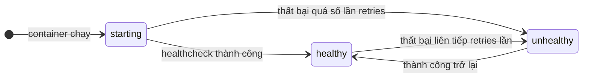
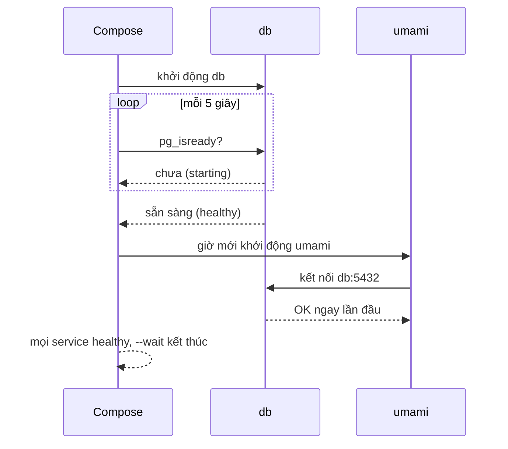

# Healthcheck: chờ đúng lúc database sẵn sàng

Chương 5 thấy Umami gõ cửa Postgres quá sớm, thất bại, rồi nhờ `restart: on-failure` mà thử lại được. Chạy được, nhưng giống cách "cứ gọi điện liên tục tới khi có người nhấc máy". Bài này làm đúng cách: **hỏi thăm sức khỏe** Postgres, chỉ khi nó sẵn sàng mới cho Umami khởi động.

## 1. Bản chất: "đang chạy" khác "sẵn sàng"

| Câu hỏi | Ai trả lời | Ví dụ Postgres |
| --- | --- | --- |
| Container **đang chạy** chưa? | Docker, nhìn tiến trình | Có, từ giây thứ 0 |
| Ứng dụng **sẵn sàng** nhận việc chưa? | Chỉ ứng dụng biết | Chưa, tới giây thứ 3–10 mới nhận kết nối |

Ví von: nhà hàng **mở cửa** (container chạy) không có nghĩa bếp đã **sẵn sàng nấu** (ứng dụng sẵn sàng). Đầu bếp còn phải bật bếp, sơ chế. Khách vào quá sớm thì phải chờ, hoặc bị mời ra.

`depends_on` dạng ngắn chỉ chờ "mở cửa". Ta cần cách hỏi "bếp sẵn sàng chưa?".

## 2. Healthcheck

**Healthcheck** (*khám sức khỏe*) là một lệnh Docker chạy **định kỳ bên trong container** để hỏi ứng dụng "ổn chưa?". Lệnh trả về mã thoát `0` là ổn, khác `0` là chưa.

Kết quả làm container có thêm một trạng thái sức khỏe:



| Trạng thái | Nghĩa |
| --- | --- |
| `starting` | Đang trong thời gian chờ, chưa có kết luận |
| `healthy` | Lệnh kiểm tra vừa thành công: **sẵn sàng** |
| `unhealthy` | Lệnh kiểm tra thất bại liên tiếp nhiều lần |

Mỗi ứng dụng có cách hỏi riêng:

- **Postgres** có sẵn công cụ `pg_isready` (*is ready*, đã sẵn sàng chưa): trả về `0` khi nhận kết nối.
- **Umami** có đường dẫn `/api/heartbeat`, trả `{"ok":true}` khi sống.
- **nginx**: tải thử trang chủ.

## 3. compose.yaml có healthcheck

```yaml
services:
  web:
    build: .
    ports:
      - "${WEB_PORT:-8080}:80"
    healthcheck:
      test: ["CMD-SHELL", "wget -qO /dev/null http://localhost/ || exit 1"]
      interval: 5s
      timeout: 3s
      retries: 5

  umami:
    image: ghcr.io/umami-software/umami:3.5.0
    ports:
      - "3000:3000"
    env_file: .env
    environment:
      DATABASE_URL: postgresql://umami:${POSTGRES_PASSWORD}@db:5432/umami
    depends_on:
      db:
        condition: service_healthy
    restart: on-failure
    healthcheck:
      test: ["CMD-SHELL", "curl -fs http://localhost:3000/api/heartbeat || exit 1"]
      interval: 5s
      timeout: 5s
      retries: 20
      start_period: 30s

  db:
    image: postgres:18-alpine
    environment:
      POSTGRES_DB: umami
      POSTGRES_USER: umami
      POSTGRES_PASSWORD: ${POSTGRES_PASSWORD}
    volumes:
      - umami-db:/var/lib/postgresql
    healthcheck:
      test: ["CMD-SHELL", "pg_isready -U umami -d umami"]
      interval: 5s
      timeout: 5s
      retries: 10

volumes:
  umami-db:
```

**Đọc hiểu** khối `healthcheck`:

| Khóa | Nghĩa | Ở `db` |
| --- | --- | --- |
| `test` | Lệnh kiểm tra. `CMD-SHELL` = chạy chuỗi phía sau bằng shell trong container | `pg_isready -U umami -d umami`: hỏi database `umami` đã nhận kết nối của user `umami` chưa |
| `interval` | Bao lâu kiểm tra một lần | 5 giây |
| `timeout` | Lệnh chạy quá lâu thì coi như thất bại | 5 giây |
| `retries` | Thất bại liên tiếp bao nhiêu lần thì thành `unhealthy` | 10 lần |
| `start_period` | Thời gian đầu được "miễn tính": thất bại chưa bị đếm | (Umami: 30 giây, vì lần đầu phải tạo bảng) |

Lệnh kiểm tra của từng service:

- `web`: `wget -qO /dev/null http://localhost/ || exit 1`: tải trang chủ, bỏ nội dung đi (`/dev/null` là "thùng rác" của Linux). Lỗi thì `exit 1`. `localhost` ở đây là **chính container `web`** (chương 4), đúng chỗ cần hỏi.
- `umami`: `curl -fs …/api/heartbeat`: `-f` = *fail*, trả lỗi nếu mã HTTP là lỗi; `-s` = *silent*, im lặng.
- Lệnh kiểm tra phải **có sẵn trong image**: image nginx Alpine có `wget`, image Umami có `curl`, image Postgres có `pg_isready`.

**Đọc hiểu** `depends_on` dạng đầy đủ:

```yaml
    depends_on:
      db:
        condition: service_healthy
```

`condition: service_healthy` (*điều kiện: service đã khỏe*): Compose chỉ khởi động `umami` khi `db` đã **healthy**. Đây là khác biệt so với chương 5.

## 4. Chạy với --wait

```bash
docker compose up -d --wait
```

**Đọc hiểu:** `--wait` bảo Compose **chờ tới khi mọi service healthy** rồi mới trả lại terminal. Nếu một service thành `unhealthy` hoặc thoát, lệnh báo lỗi. Rất tiện: lệnh kết thúc thành công nghĩa là cả hệ thống **thật sự** dùng được.

```text
 Container my-site-db-1  Healthy
 Container my-site-web-1  Healthy
 Container my-site-umami-1  Healthy
```

```bash
docker compose ps
```

```text
SERVICE   STATUS
db        Up 21 seconds (healthy)
umami     Up 16 seconds (healthy)
web       Up 21 seconds (healthy)
```

(Đã bỏ bớt cột cho gọn.) Để ý `umami` bắt đầu **sau** `db` khoảng 5 giây: đúng khoảng thời gian chờ `db` healthy. Và `docker compose logs umami` giờ không còn dòng `Can't reach database server` nào.




## 5. Xem chi tiết một healthcheck

Khi một service mãi không healthy, xem các lần kiểm tra gần nhất:

```bash
docker inspect --format "{{json .State.Health}}" my-site-db-1
```

**Đọc hiểu:** `inspect` in chi tiết một container; `--format` chọn đúng phần `Health`. Kết quả có `Status` và danh sách `Log`, mỗi lần kiểm tra có `ExitCode` và `Output`, cho biết lệnh kiểm tra đã in ra gì. Dùng dấu nháy kép cho `--format` để chạy được cả trên PowerShell và bash.

## 6. Sai lầm thường gặp

| Sai lầm | Hậu quả | Đúng |
| --- | --- | --- |
| Healthcheck dùng lệnh không có trong image (ví dụ `bash` hay `pg_isready` trong image nginx) | Mãi `unhealthy`, `up --wait` báo lỗi | Kiểm tra lệnh có sẵn: `docker compose exec web which wget` |
| Healthcheck gọi sai cổng (ví dụ `localhost:8080` trong container `web`) | Mãi `unhealthy` | Gọi cổng ứng dụng nghe **bên trong** container (nginx: 80) |
| Có healthcheck nhưng `depends_on` vẫn dạng ngắn | Vẫn khởi động sớm | `condition: service_healthy` |
| `start_period` quá ngắn cho ứng dụng chậm | `unhealthy` trước khi kịp sẵn sàng | Tăng `start_period` |

## 7. Ngoài thực tế

Healthcheck không chỉ dùng cho Compose. Ở máy chủ thật, hệ thống điều phối (như Kubernetes) và bộ cân bằng tải dùng đúng ý tưởng này: **chỉ gửi người dùng tới container đã healthy**, và tự thay container `unhealthy`. Khi deploy bản mới, container mới phải healthy rồi container cũ mới bị tắt, nhờ vậy người dùng không thấy trang lỗi. Trong CI, `docker compose up --wait` là cách phổ biến để "dựng cả hệ thống, chắc chắn nó chạy, rồi mới chạy test".

## 8. Khi bị lỗi

| Lỗi | Vì sao | Cách sửa |
| --- | --- | --- |
| `container my-site-web-1 is unhealthy` khi `up --wait` | Lệnh healthcheck thất bại | `docker inspect --format "{{json .State.Health}}" my-site-web-1`, đọc `Output` |
| `dependency failed to start: container my-site-db-1 is unhealthy` | `db` không healthy nên `umami` không được khởi động | `docker compose logs db`; thường là thiếu `POSTGRES_PASSWORD` hoặc sai `-U`/`-d` trong `pg_isready` |
| `up --wait` chờ rất lâu | `retries` × `interval` lớn, ứng dụng không bao giờ sẵn sàng | Xem log của service đang `starting` |
| Lỗi khác, hoặc chưa hiểu vì sao | | Nhắn mentor, công khai hay **nhắn riêng** đều được (tab **Cài đặt** → "Hỏi ở đâu") |

## Tóm tắt

- Container chạy chưa chắc ứng dụng đã sẵn sàng; healthcheck hỏi chính ứng dụng.
- `healthcheck`: `test`, `interval`, `timeout`, `retries`, `start_period`.
- `depends_on` + `condition: service_healthy` chờ service kia **healthy**.
- `docker compose up -d --wait` chỉ xong khi mọi service healthy.
