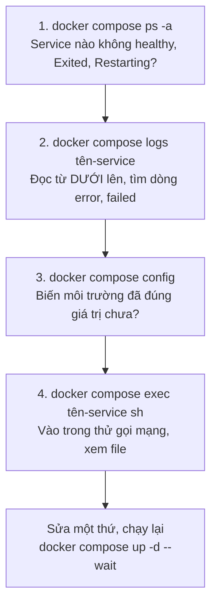
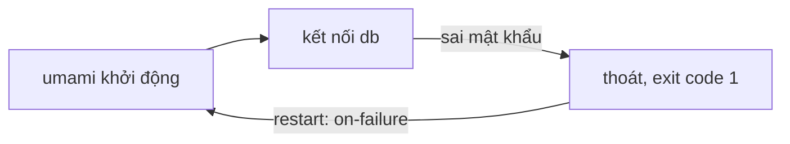

# Gỡ lỗi Compose: trùng cổng, sai biến, crash loop

Mỗi mục dưới đây là một lỗi được **cố tình tạo ra**. Làm theo để thấy lỗi tận mắt, đọc thông báo, rồi sửa. Lần sau gặp thật, bạn nhận ra ngay. Dùng `compose.yaml` có healthcheck của bài trước.

## 1. Quy trình 4 bước

Khi stack không chạy, đừng sửa lung tung. Đi đúng thứ tự:



| Bước | Lệnh | Trả lời câu hỏi |
| --- | --- | --- |
| 1 | `docker compose ps -a` | **Cái gì** hỏng? (`-a` để thấy cả service đã thoát) |
| 2 | `docker compose logs <service>` | **Vì sao** hỏng? |
| 3 | `docker compose config` | Compose có hiểu **đúng** file và biến không? |
| 4 | `docker compose exec <service> sh` | Từ **bên trong**, mọi thứ trông thế nào? |

Mỗi lần **chỉ sửa một thứ** rồi chạy lại. Sửa ba thứ cùng lúc thì không biết cái nào có tác dụng.

Đọc trạng thái trong cột `STATUS`:

| Trạng thái | Nghĩa |
| --- | --- |
| `Up 2 minutes (healthy)` | Chạy và sẵn sàng |
| `Up 10 seconds (health: starting)` | Đang chờ healthcheck |
| `Up 3 minutes (unhealthy)` | Chạy nhưng healthcheck thất bại |
| `Exited (1) 5 seconds ago` | Đã thoát. Số trong ngoặc là **exit code** (*mã thoát*): `0` là kết thúc bình thường, khác `0` là lỗi |
| `Restarting (1) 3 seconds ago` | Đang trong vòng thoát rồi chạy lại: **crash loop** (mục 4) |

## 2. Lỗi 1: trùng cổng

Giả lập một chương trình khác đang giữ cổng 8080:

```bash
docker compose down
docker run -d --name chiem-cong -p 8080:80 nginx:1.30-alpine
docker compose up -d --wait
```

```text
Error response from daemon: failed to set up container networking: driver failed programming external connectivity on endpoint my-site-web-1 (…): Bind for 0.0.0.0:8080 failed: port is already allocated
```

**Đọc hiểu:** thông báo dài, nhưng phần quan trọng ở **cuối**: `Bind for 0.0.0.0:8080 failed: port is already allocated`, cổng 8080 trên máy đã có người dùng. Tìm ai đang giữ:

```bash
docker ps --filter publish=8080
```

**Đọc hiểu:** `--filter publish=8080` (*lọc*) chỉ hiện container đang mở cổng 8080. Thấy `chiem-cong`. Nếu không thấy container nào, đó là một chương trình trên máy bạn (tab **Cài đặt**, mục 1 có lệnh tìm).

**Sửa**, chọn một trong hai:

- Tắt thứ đang giữ cổng: `docker rm -f chiem-cong`.
- Hoặc đổi cổng của bạn mà không sửa `compose.yaml`: thêm `WEB_PORT=8081` vào `.env` (bài 1), rồi `docker compose up -d --wait` và mở `localhost:8081`.

Dọn: `docker rm -f chiem-cong`, bỏ dòng `WEB_PORT` khỏi `.env`.

## 3. Lỗi 2: thiếu hoặc sai biến môi trường

Đổi tên `.env` thành `.env.bak` (trong VS Code, hoặc `mv .env .env.bak`; PowerShell hiểu `mv`), rồi:

```bash
docker compose up -d
```

```text
level=warning msg="The \"POSTGRES_PASSWORD\" variable is not set. Defaulting to a blank string."
env file …/my-site/.env not found: …
```

**Đọc hiểu:** hai thông báo, đúng hai cơ chế của bài 1:

- `variable is not set. Defaulting to a blank string`: `${POSTGRES_PASSWORD}` không có giá trị, Compose thay bằng **chuỗi rỗng**. Chỉ là **cảnh báo** (warning): rất dễ bỏ qua, và là thứ nguy hiểm hơn.
- `env file … not found`: `env_file: .env` không tìm thấy file. Đây là **lỗi**, Compose dừng.

Một biến thể khó thấy hơn: `.env` có, nhưng **gõ sai tên biến**, ví dụ `POSTGRES_PASWORD=…` (thiếu một chữ S). Không có lỗi `not found`, chỉ có cảnh báo `variable is not set`. Bước 3 của quy trình bắt được ngay:

```bash
docker compose config
```

**Đọc hiểu:** tìm dòng `DATABASE_URL`. Nếu thấy `postgresql://umami:@db:5432/umami`, chỗ mật khẩu **trống**: biến chưa được thay.

**Sửa:** đổi tên lại `.env`, kiểm tra tên biến khớp từng chữ giữa `.env` và `compose.yaml`. README của dự án phải ghi bước `cp .env.example .env`, vì ai mới clone về cũng gặp lỗi này.

## 4. Lỗi 3: crash loop vì sai mật khẩu

Đổi `POSTGRES_PASSWORD` trong `.env` sang một giá trị khác, rồi:

```bash
docker compose up -d
```

Chờ khoảng 40 giây, rồi:

```bash
docker compose ps -a
```

```text
SERVICE   STATUS
db        Up 46 seconds (healthy)
umami     Restarting (1) 9 seconds ago
web       Up 46 seconds (healthy)
```

```bash
docker compose logs umami
```

```text
umami-1  | Raw query failed. Code: `28P01`. Message: `password authentication failed for user "umami"`
umami-1  | Raw query failed. Code: `28P01`. Message: `password authentication failed for user "umami"`
```

**Đọc hiểu:**

- `db` vẫn **healthy**: `pg_isready` chỉ hỏi "nhận kết nối chưa", không kiểm tra mật khẩu.
- `umami` ở trạng thái `Restarting (1)`: nó kết nối, bị từ chối mật khẩu, thoát với exit code `1`, `restart: on-failure` chạy lại nó, lại bị từ chối… Vòng lặp này gọi là **crash loop** (*vòng lặp sập*).
- Log lặp đi lặp lại cùng một dòng: dấu hiệu điển hình của crash loop. Đọc **một** dòng là đủ biết nguyên nhân.



Vì sao sai mật khẩu, khi `.env` đã đổi cho cả hai? Chương 4: Postgres chỉ đặt mật khẩu **lần đầu** khởi tạo volume. Volume `my-site_umami-db` vẫn giữ mật khẩu cũ; `db` mới đọc `POSTGRES_PASSWORD` mới nhưng bỏ qua nó. Umami thì dùng mật khẩu mới.

**Sửa**, chọn một:

- Trả lại mật khẩu cũ trong `.env`.
- Hoặc, nếu dữ liệu không quan trọng: `docker compose down -v` (xóa volume) rồi `up -d --wait`, Postgres khởi tạo lại với mật khẩu mới.

Muốn đổi mật khẩu mà giữ dữ liệu thì phải đổi **bên trong** Postgres bằng lệnh SQL `ALTER USER`; ngoài phạm vi track này.

## 5. Lỗi 4: healthy mà không vào được

Sửa cổng của Umami thành `"3000:3001"` rồi:

```bash
docker compose up -d --wait
curl http://localhost:3000/api/heartbeat
```

```text
curl: (52) Empty reply from server
```

(Windows `curl.exe` có thể báo `Recv failure: Connection was reset`.) Nhưng `docker compose ps` vẫn báo Umami **healthy**!

**Đọc hiểu:** healthcheck chạy **bên trong** container, gọi đúng `localhost:3000`, nên khỏe. Lỗi nằm ở **đường chuyển tiếp** từ máy bạn: `3000:3001` dẫn vào cổng 3001 của container, nơi không có ai nghe (chương 1, "số phòng"). Cột `PORTS` cho thấy ngay: `0.0.0.0:3000->3001/tcp`.

**Sửa:** số **bên phải** của `ports` phải là cổng ứng dụng nghe trong container (Umami 3000, nginx 80). Số bên trái tùy bạn.

## 6. Bảng tra nhanh

| Triệu chứng | Xem ở đâu | Nguyên nhân hay gặp |
| --- | --- | --- |
| `port is already allocated` | `docker ps --filter publish=<cổng>` | Container hoặc chương trình khác giữ cổng |
| `variable is not set` | `.env`, `docker compose config` | Thiếu `.env`, sai tên biến |
| `env file … not found` | thư mục project | Chưa `cp .env.example .env` |
| Service `Restarting (1)` | `docker compose logs <service>` | Crash loop: sai mật khẩu, sai `DATABASE_URL`, thiếu biến |
| Service `Exited (1)` | `docker compose logs <service>` | Lỗi khi khởi động, không có `restart` |
| `unhealthy` | `docker inspect --format "{{json .State.Health}}" <container>` | Lệnh healthcheck sai, sai cổng bên trong |
| Healthy nhưng trình duyệt không vào được | cột `PORTS` | Sai số bên phải của `ports` |
| Sửa code mà trang không đổi | lệnh đã chạy | Quên `--build` |

## 7. Sai lầm thường gặp

| Sai lầm | Thật ra |
| --- | --- |
| `docker compose down -v` mỗi khi có lỗi | Xóa sạch dữ liệu. Chỉ dùng khi đã hiểu lỗi là do volume và chấp nhận mất dữ liệu |
| Đọc log từ trên xuống, dừng ở dòng cảnh báo đầu | Đọc từ dưới lên, tìm dòng `error`, `failed` cuối cùng |
| Thấy `healthy` là nghĩ mọi thứ đều đúng | Healthy chỉ nói về bên trong container. Còn `ports`, mật khẩu ở service khác |
| Hỏi "Docker không chạy" mà không kèm gì | Gửi kèm output `docker compose ps -a` và vài dòng log cuối, đã che mật khẩu |

## 8. Ngoài thực tế

Khi nhắn hỏi đồng nghiệp hay mở issue về lỗi, người có kinh nghiệm luôn gửi kèm đúng những thứ của quy trình 4 bước: trạng thái (`ps -a`), vài chục dòng log cuối, và phiên bản (`docker compose version`). Người nhận đọc là hiểu ngay, không phải hỏi lại. Đó cũng là cách nên hỏi mentor của track. Nhớ **che mật khẩu và token** trong log và trong output `docker compose config`.

Ở công ty, crash loop trên máy chủ thường được hệ thống giám sát phát hiện (container khởi động lại quá nhiều lần) và báo cho người trực. Việc đầu tiên họ làm vẫn là `logs`.

## 9. Khi bị lỗi

| Lỗi | Vì sao | Cách sửa |
| --- | --- | --- |
| Làm xong các lỗi thử mà stack vẫn không lên | Còn sót một chỗ sửa thử | So `compose.yaml` với bài "Healthcheck"; `.env` với `.env.example`; `docker rm -f chiem-cong` |
| Không biết mật khẩu cũ để trả lại | | `docker compose down -v` rồi `up -d --wait` (mất dữ liệu thử) |
| Lỗi khác, hoặc chưa hiểu vì sao | | Nhắn mentor, công khai hay **nhắn riêng** đều được (tab **Cài đặt** → "Hỏi ở đâu"), kèm output `ps -a` và log, **đã che mật khẩu** |

## Tóm tắt

- Quy trình: `ps -a` → `logs` → `config` → `exec`; mỗi lần sửa một thứ.
- `port is already allocated`: tìm bằng `docker ps --filter publish=…`, hoặc đổi cổng bằng `WEB_PORT` trong `.env`.
- `variable is not set` là cảnh báo dễ bỏ qua; `docker compose config` cho thấy giá trị thật.
- `Restarting (1)` là crash loop; đọc một dòng log lặp lại là ra nguyên nhân.
- Healthy chỉ nói về bên trong container; vào không được thì xem `ports`.
