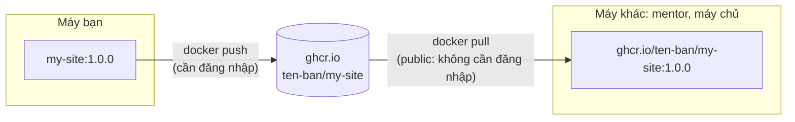

# Push image lên GHCR

Image `my-site` của bạn đang chỉ nằm trên máy bạn. Muốn mentor, bạn cùng nhóm, hay một máy chủ chạy nó, họ phải build lại từ code. Đưa image lên **registry** (chương 1) thì bất kỳ máy nào cũng `docker pull` về chạy được ngay, và chạy **đúng** bản bạn đã thử.

**GHCR** (*GitHub Container Registry*, kho container của GitHub) ở địa chỉ `ghcr.io`, gắn với tài khoản GitHub bạn đã có. **Docker Hub** (`docker.io`) là registry mặc định mà bạn vẫn pull `nginx`, `postgres` từ đó. Bài này làm với GHCR, mục 7 nói cách làm với Docker Hub.



## 1. Tên image đầy đủ

Để push lên registry, tên image phải nói rõ **đi đâu**:

```text
ghcr.io/ten-ban/my-site:1.0.0
└──┬──┘ └──┬──┘ └──┬──┘ └─┬─┘
registry namespace  tên    tag
```

**Đọc hiểu:**

- `ghcr.io`: địa chỉ registry. Không ghi thì Docker hiểu là Docker Hub.
- `ten-ban`: **namespace** (*không gian tên*), ở GHCR là **tên tài khoản GitHub** của bạn (hoặc tên tổ chức). Bạn chỉ push được vào namespace của mình. Thay `ten-ban` bằng tên GitHub của bạn trong mọi lệnh bài này.
- `my-site`: tên image.
- `1.0.0`: tag (chương 2).
- **Chỉ dùng chữ thường.** Tên GitHub `An-Nguyen` thì viết `an-nguyen`, nếu không Docker báo `repository name must be lowercase`.

Image `my-site:dev` trên máy có thể đã cũ (build từ chương 2, trước khi bạn sửa trang hay thêm `.dockerignore`). Vì vậy build lại ngay với tên đầy đủ, đứng trong thư mục `my-site`:

```bash
docker build -t ghcr.io/ten-ban/my-site:1.0.0 .
docker image ls ghcr.io/ten-ban/my-site
```

**Đọc hiểu:** giống `docker build` của chương 2, chỉ khác tên image. Image mới phản ánh đúng code hiện tại. (Muốn gắn tên đầy đủ cho một image đã build sẵn thì dùng `docker tag`, chương 2: `tag` không tạo bản sao.)

## 2. Vì sao cần token, không dùng mật khẩu

Push là **ghi** vào tài khoản của bạn, nên registry phải biết bạn là ai. GitHub **không** cho đăng nhập dòng lệnh bằng mật khẩu tài khoản. Thay vào đó dùng **PAT** (*Personal Access Token*, mã truy cập cá nhân): một chuỗi bí mật GitHub cấp riêng cho việc này.

| | Mật khẩu tài khoản | PAT |
| --- | --- | --- |
| Làm được | Mọi thứ với tài khoản | Chỉ những quyền bạn chọn |
| Hết hạn | Không | Có, bạn đặt ngày |
| Lộ ra thì | Mất tài khoản | Thu hồi token đó, tài khoản vẫn an toàn |

## 3. Tạo PAT với quyền tối thiểu

1. Trên GitHub: ảnh đại diện → **Settings** → **Developer settings** → **Personal access tokens** → **Tokens (classic)** → **Generate new token (classic)**.
2. **Note** (ghi chú): `docker-basics ghcr` để sau này nhớ token dùng làm gì.
3. **Expiration** (hạn dùng): 30 ngày là đủ cho track.
4. **Select scopes** (chọn quyền): chỉ tích **`write:packages`** (tự kèm `read:packages`). Không tích gì khác. Token chỉ có đúng quyền cần dùng: lộ ra thì thiệt hại nhỏ nhất.
5. **Generate token**, rồi **copy ngay**: GitHub chỉ hiện token **một lần**.

Token có dạng `ghp_` theo sau là một dãy ký tự dài. **Quy tắc bắt buộc:**

- **Không** dán token vào Discord, bài nộp, README, ảnh chụp màn hình, file trong repo, hay hỏi AI kèm token.
- Cất vào trình quản lý mật khẩu nếu cần dùng lại.
- Lỡ dán ở đâu đó: vào lại trang token, bấm **Delete** để thu hồi, rồi tạo token mới. Không xấu hổ gì cả; người đi làm cũng thỉnh thoảng gặp, quan trọng là thu hồi ngay.

## 4. Đăng nhập

```bash
docker login ghcr.io -u ten-ban
```

Docker hỏi `Password:`. **Dán token** (không phải mật khẩu GitHub) rồi Enter. Khi dán, màn hình **không hiện gì**, kể cả dấu `*`: bình thường, cứ Enter.

```text
Login Succeeded
```

**Đọc hiểu:**

- `login` (*đăng nhập*): lưu thông tin đăng nhập registry `ghcr.io` trên máy, để `push` sau đó dùng.
- `-u` = *username*: tên GitHub của bạn.
- Gõ token qua dấu nhắc `Password:` để token **không nằm trong lịch sử lệnh** của terminal. Đừng dùng `-p <token>` trên dòng lệnh: lịch sử lệnh lưu lại nó.
- Docker Desktop cất thông tin đăng nhập vào kho mật khẩu của hệ điều hành (Windows Credential Manager, macOS Keychain).
- Trên Linux dùng Docker Engine, hay trong Codespaces, thường **không có** kho mật khẩu đó: Docker ghi token vào file `~/.docker/config.json`, chỉ mã hóa base64 (đổi dạng, **không phải** mã hóa bảo mật), và in cảnh báo `Your password will be stored unencrypted`. Ai đọc được file đó là có token. Trên máy dùng chung (phòng lab, máy bạn bè), **luôn chạy `docker logout ghcr.io`** khi xong việc: lệnh này xóa token khỏi máy.

## 5. Push

```bash
docker push ghcr.io/ten-ban/my-site:1.0.0
```

Output lần push đầu tiên (rút gọn; mã layer của bạn sẽ khác):

```text
The push refers to repository [ghcr.io/ten-ban/my-site]
3fe2b486249e: Waiting
0a2538e70241: Waiting
…
3fe2b486249e: Pushed
0a2538e70241: Pushed
…
1.0.0: digest: sha256:764b7563f5d5… size: 856
```

**Đọc hiểu:** `push` (*đẩy*) tải image lên registry, **từng layer một** (chương 2). Mỗi dòng bắt đầu bằng mã của một layer: `Waiting` là đang xếp hàng, `Pushed` là đã tải lên xong. Lần push đầu tiên lên GHCR, **mọi** layer đều hiện `Pushed`, kể cả các layer nền của nginx: GHCR là registry khác Docker Hub, nó chưa có layer nào của bạn. Dòng cuối có `digest: sha256:…` (bài sau giải thích).

Push lần nữa, ví dụ thêm tag `latest` cho cùng image:

```bash
docker tag ghcr.io/ten-ban/my-site:1.0.0 ghcr.io/ten-ban/my-site:latest
docker push ghcr.io/ten-ban/my-site:latest
```

```text
3fe2b486249e: Layer already exists
0a2538e70241: Layer already exists
…
latest: digest: sha256:764b7563f5d5… size: 856
```

**Đọc hiểu:** registry đã có mọi layer nên không tải lại gì, chỉ ghi thêm nhãn `latest`. Digest giống hệt bản `1.0.0`: cùng một image, hai nhãn (chương 2). Khi bạn sửa trang và push bản `1.0.1`, hầu hết các dòng là `Layer already exists`, chỉ khoảng hai dòng `Pushed`: layer `COPY site/` mới và một phần thông tin nhỏ đi kèm image. Đó là lợi ích của layer dùng chung: bản cập nhật chỉ tải phần thay đổi.

Dùng Mac chip Apple (M1, M2…)? Image bạn build ra là bản **arm64**, máy amd64 của mentor sẽ không chạy được. Bài sau, mục 5 (phần **nâng cao**), chỉ cách build cho cả hai loại máy.

## 6. Xem và đổi visibility

Mở `https://github.com/ten-ban?tab=packages`: thấy package `my-site`. Theo tài liệu của GitHub, image push lên GHCR **từ máy bạn bằng PAT** tạo ra một package **private** (*riêng tư*) và **chưa nối với repo nào**: chỉ bạn pull được.

**Visibility** (*mức hiển thị*):

| | Public | Private |
| --- | --- | --- |
| Ai pull được | Mọi người, không cần đăng nhập | Chỉ người có quyền, phải `docker login` |
| Dùng khi | Dự án mở, bài nộp cho mentor | Dự án công ty, có code không muốn công khai |

Để mentor pull được bài của bạn: mở package → **Package settings** → **Change visibility** → **Public**. Trước khi đổi sang public, nhớ chương 3: image **không** được chứa `.env` hay bí mật nào, vì ai cũng tải về và mở ra được.

Nên **nối package với repo** của bạn, để trang repo hiện package ở mục **Packages** và người xem biết image build từ code nào. Hai cách:

- Trong trang package: **Package settings** → **Connect repository** (hoặc nút **Connect Repository** trên trang package), chọn repo `my-site`.
- Hoặc thêm một dòng vào `Dockerfile`, rồi build và push lại; GHCR tự nối package với repo ghi trong đó:

  ```dockerfile
  LABEL org.opencontainers.image.source=https://github.com/ten-ban/my-site
  ```

  **Đọc hiểu:** `LABEL` gắn một nhãn thông tin (khóa = giá trị) vào image, không ảnh hưởng gì lúc chạy. Khóa `org.opencontainers.image.source` là quy ước chung cho "mã nguồn của image này ở đâu".

**Khác biệt khi push từ GitHub Actions.** Nếu sau này bạn để GitHub Actions push (track **GitHub Actions và Docker**), dùng `GITHUB_TOKEN` của workflow và đặt tên image theo repo, ví dụ `ghcr.io/ten-ban/my-site/my-site:1.0.0`, thì package được **tự nối với repo** và **thừa hưởng visibility** của repo. CLB đã chạy thử trên một repo public: package mới tạo là **public** ngay, pull được mà không cần đăng nhập, không phải đổi gì.

Trên trang package, mục **Versions** có thể hiện thêm vài phiên bản **untagged** (không có nhãn) bên cạnh `1.0.0`, `latest`. Đó là các phần thông tin Docker gửi kèm image (danh sách nền tảng, chứng từ build), không phải bản thừa; đừng xóa chúng.

## 7. Docker Hub thì sao?

Cách làm giống hệt, chỉ khác tên và nơi lấy token:

| | GHCR | Docker Hub |
| --- | --- | --- |
| Tên image | `ghcr.io/ten-ban/my-site:1.0.0` | `ten-ban-dockerhub/my-site:1.0.0` (không ghi registry) |
| Token | GitHub PAT, quyền `write:packages` | Docker Hub → Account settings → Personal access tokens |
| Đăng nhập | `docker login ghcr.io -u ten-ban` | `docker login -u ten-ban-dockerhub` |
| Mặc định | private | public |

Track này dùng GHCR vì bạn đã có tài khoản GitHub và không cần đăng ký thêm.

## 8. Sai lầm thường gặp

| Sai lầm | Hậu quả | Đúng |
| --- | --- | --- |
| Push `my-site:1.0.0` (không có `ghcr.io/…`) | Docker cố push lên Docker Hub, namespace `library`, bị từ chối | Tag đầy đủ `ghcr.io/ten-ban/my-site:1.0.0` |
| Dán mật khẩu GitHub thay vì token | `denied` / `unauthorized` | Dán PAT |
| Token thiếu quyền `write:packages` | `denied: permission_denied` | Tạo token mới đúng quyền |
| Chụp màn hình có token để hỏi | Token lộ | Che token; lỡ lộ thì thu hồi ngay |
| Đổi package sang public khi image có `.env` | Mật khẩu lộ cho mọi người | Kiểm tra `.dockerignore` trước (chương 3) |

## 9. Ngoài thực tế

Ở công ty, **con người hiếm khi tự push** image dùng cho máy chủ. Máy CI build từ code đã được review, đăng nhập registry bằng một token **tự động, ngắn hạn** (ví dụ `GITHUB_TOKEN` trong GitHub Actions), rồi push. Người chỉ pull về để thử. Nhờ vậy image trên registry luôn khớp với một commit đã review, và không ai phải cầm token dài hạn trên laptop. Track **GitHub Actions và Docker** dạy cách làm đó.

Khi rời một dự án hay đổi máy, người cẩn thận thu hồi các PAT không dùng nữa, và chạy `docker logout`.

## 10. Khi bị lỗi

| Lỗi | Vì sao | Cách sửa |
| --- | --- | --- |
| `repository name must be lowercase` | Tên có chữ hoa | Viết thường toàn bộ |
| `unauthorized` / `denied` khi login | Dán sai, dán mật khẩu GitHub, hoặc token hết hạn | Tạo token mới, dán lại |
| `denied: permission_denied: The token provided does not match expected scopes` | Token thiếu `write:packages` | Tạo token mới đúng quyền |
| `denied: requested access to the resource is denied` khi push | Push vào namespace không phải của bạn, hoặc tên thiếu `ghcr.io/` | Kiểm tra namespace là tên GitHub của bạn |
| `An image does not exist locally with the tag` | Chưa build hoặc tag image với tên đầy đủ | `docker build -t ghcr.io/ten-ban/my-site:1.0.0 .` |
| Lỗi khác, hoặc chưa hiểu vì sao | | Nhắn mentor, công khai hay **nhắn riêng** đều được (tab **Cài đặt** → "Hỏi ở đâu"). **Che token** trước khi gửi |

## Tóm tắt

- Tên image để push: `registry/namespace/tên:tag`, chữ thường.
- Đăng nhập GHCR bằng PAT quyền `write:packages`, gõ qua dấu nhắc `Password:`; không bao giờ dán token ra ngoài.
- `docker push` tải image lên; layer đã có trên registry không tải lại.
- GHCR mặc định private; đổi sang public khi muốn người khác pull không cần đăng nhập.
