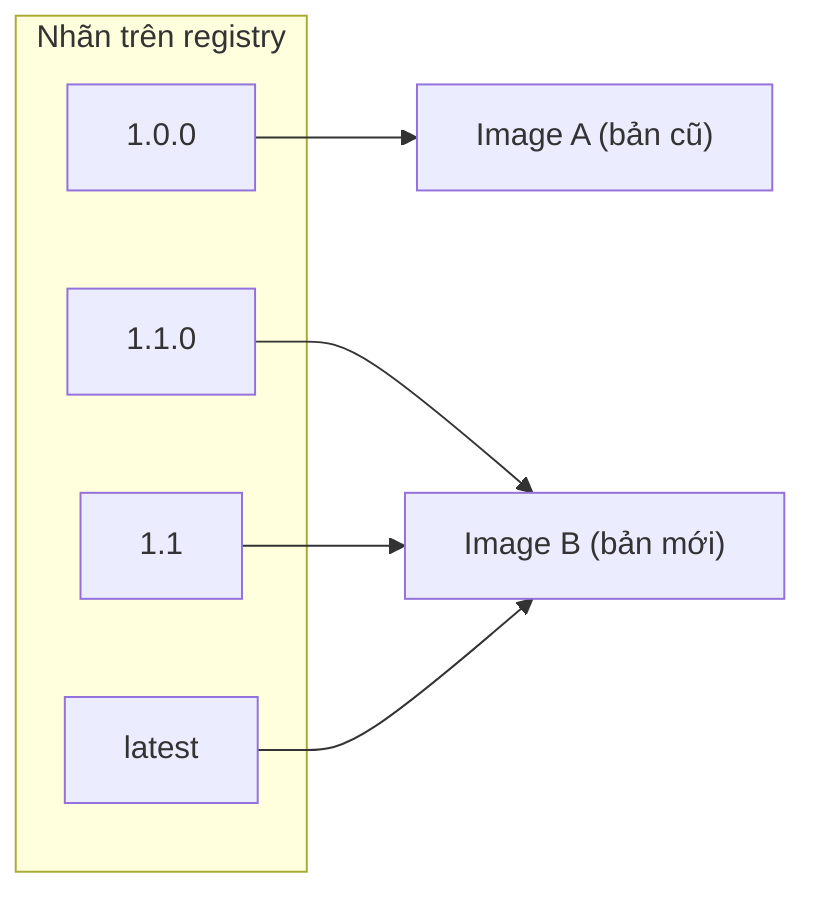

# Phiên bản, digest và pull trên máy khác

Bài trước push `ghcr.io/ten-ban/my-site:1.0.0`. Bài này trả lời: lần sau sửa trang thì đặt tag gì? Người khác nên pull tag nào? Và làm sao chắc chắn hai máy chạy **cùng một** image?

## 1. Semver: ba con số có nghĩa

**Semver** (*semantic versioning*, đánh số phiên bản theo ngữ nghĩa) viết phiên bản dạng `MAJOR.MINOR.PATCH`, ví dụ `1.4.2`:

| Phần | Tăng khi | Ví dụ với trang web | Từ `1.4.2` thành |
| --- | --- | --- | --- |
| **PATCH** (*bản vá*) | Sửa lỗi, không đổi cách dùng | sửa lỗi chính tả, sửa CSS lệch | `1.4.3` |
| **MINOR** (*nhỏ*) | Thêm tính năng, cách dùng cũ vẫn chạy | thêm trang "Dự án" | `1.5.0` |
| **MAJOR** (*lớn*) | Thay đổi làm hỏng cách dùng cũ | đổi cổng từ 80 sang 8080, đổi biến môi trường bắt buộc | `2.0.0` |

Tăng số trước thì **đưa các số sau về 0**. Nhìn số là người dùng image biết có an toàn để nâng cấp không: `1.4.2` → `1.4.3` thì yên tâm, `1.x` → `2.0.0` thì phải đọc ghi chú thay đổi.

## 2. Một bản phát hành, nhiều tag

Thường người ta push cùng một image với vài tag, để người dùng chọn mức "bám" phiên bản:

```bash
docker build -t ghcr.io/ten-ban/my-site:1.1.0 .
docker tag ghcr.io/ten-ban/my-site:1.1.0 ghcr.io/ten-ban/my-site:1.1
docker tag ghcr.io/ten-ban/my-site:1.1.0 ghcr.io/ten-ban/my-site:latest
docker push ghcr.io/ten-ban/my-site:1.1.0
docker push ghcr.io/ten-ban/my-site:1.1
docker push ghcr.io/ten-ban/my-site:latest
```

**Đọc hiểu:** một image, ba nhãn. Push nhãn thứ hai, thứ ba rất nhanh vì mọi layer đã có trên registry (`Layer already exists`).

| Người dùng pull | Nhận được | Hợp khi |
| --- | --- | --- |
| `my-site:1.1.0` | đúng bản này, **mãi mãi** | máy chủ thật, cần chắc chắn |
| `my-site:1.1` | bản vá mới nhất của 1.1 (`1.1.0`, sau này `1.1.1`…) | muốn tự nhận bản sửa lỗi |
| `my-site:latest` | bản mới nhất, bất kể là gì | thử nhanh trên máy |



Khi push `1.1.1`, nhãn `1.1` và `latest` được **dời** sang image mới; `1.1.0` và `1.0.0` **không bao giờ dời**. Quy tắc nhóm: **tag phiên bản đầy đủ không bao giờ bị ghi đè.** Sửa gì thì tăng số.

## 3. Digest: dấu vân tay của image

Tag có thể dời, nên tag không chứng minh hai máy chạy cùng một thứ. **Digest** (*bản tóm tắt*) thì có: mã `sha256:…` tính từ **chính nội dung** image. Nội dung khác một byte là digest khác hoàn toàn. Digest **không bao giờ đổi**.

Xem digest của một image trên registry:

```bash
docker buildx imagetools inspect nginx:1.30-alpine
```

```text
Name:      docker.io/library/nginx:1.30-alpine
MediaType: application/vnd.oci.image.index.v1+json
Digest:    sha256:8eb2b5540eae779603cc3db84b3986a15ecb5308b54303146eee9837c137b51a
```

**Đọc hiểu:** `imagetools inspect` hỏi registry thông tin của một image mà không tải nó về. Dòng `Digest` là dấu vân tay hiện tại của tag `1.30-alpine`. Số của bạn sẽ khác nếu nginx đã phát hành bản vá mới cho tag này: đúng là ví dụ cho việc tag có thể dời.

Ghim chặt bằng digest, viết `@` thay cho `:`:

```dockerfile
FROM nginx:1.30-alpine@sha256:8eb2b5540eae779603cc3db84b3986a15ecb5308b54303146eee9837c137b51a
```

**Đọc hiểu:** khi có cả tag và digest, Docker dùng **digest**; tag chỉ để người đọc dễ hiểu. Ghim digest thì build hôm nay và build năm sau dùng đúng cùng một image nền. Cái giá: phải tự cập nhật digest khi muốn nhận bản vá bảo mật. Track này dùng tag cụ thể là đủ; dự án lớn thường ghim digest và dùng công cụ tự mở pull request cập nhật.

| | `nginx` (latest) | `nginx:1.30-alpine` | `nginx:1.30-alpine@sha256:…` |
| --- | --- | --- | --- |
| Có thể đổi | Bất cứ lúc nào, cả bản lớn | Bản vá nhỏ | Không bao giờ |
| Dùng khi | Không nên dùng | Đa số trường hợp, track này | Cần lặp lại tuyệt đối |

## 4. Pull trên một máy khác

Đây là lúc thấy giá trị của registry. Chọn **một** cách:

- máy của bạn cùng nhóm, hoặc máy ở phòng lab có Docker;
- **GitHub Codespaces** hoặc **Play with Docker** (tab **Cài đặt**, mục 5): một máy Linux mới tinh trên mạng;
- giả lập trên chính máy bạn: xóa sạch image cục bộ, đăng xuất, rồi pull lại.

Cách giả lập trên máy bạn:

```bash
docker image rm ghcr.io/ten-ban/my-site:1.1.0 ghcr.io/ten-ban/my-site:1.1 ghcr.io/ten-ban/my-site:latest
docker logout ghcr.io
```

**Đọc hiểu:** gỡ các nhãn GHCR khỏi máy, và `logout` (*đăng xuất*) để chắc chắn pull **không** dùng quyền của bạn, giống một người lạ.

Rồi, trên máy khác hoặc máy vừa giả lập:

```bash
docker pull ghcr.io/ten-ban/my-site:1.1.0
docker run -d --name from-ghcr -p 8080:80 ghcr.io/ten-ban/my-site:1.1.0
```

**Đọc hiểu:** `pull` tải image từ GHCR. Package **public** thì không cần đăng nhập. Mở <http://localhost:8080>: trang của bạn, chạy từ registry, **không cần mã nguồn, không cần build**. Dọn: `docker rm -f from-ghcr`.

Nếu `pull` báo `denied` hoặc `unauthorized`: package vẫn **private** (bài trước, mục 6). Đổi visibility sang public, hoặc `docker login ghcr.io` bằng token có `read:packages`.


## 5. Sai lầm thường gặp

| Sai lầm | Hậu quả | Đúng |
| --- | --- | --- |
| Chỉ push `latest` | Không quay về được bản cũ; không biết máy nào đang chạy bản nào | Luôn có tag phiên bản đầy đủ |
| Ghi đè `1.0.0` bằng code mới | Hai máy cùng "1.0.0" nhưng khác nhau | Tăng số: `1.0.1` |
| Máy chủ chạy `:latest` | Lần khởi động lại có thể ra bản khác, hỏng bất ngờ | Máy chủ dùng tag đầy đủ hoặc digest |
| Nghĩ đã pull `latest` là có bản mới nhất | Máy giữ bản đã pull lần trước | `docker pull` lại để cập nhật |

## 6. Ngoài thực tế

Quy trình phát hành phổ biến ở các nhóm:

1. Merge pull request vào `main`.
2. Tạo tag Git `v1.1.0`.
3. CI build image, push `1.1.0`, `1.1`, `latest` lên registry, kèm ghi chú thay đổi.
4. Máy chủ được cập nhật sang `1.1.0`.
5. Có lỗi thì **rollback**: cho máy chủ chạy lại `1.0.0`, trong vài giây, vì image đó vẫn nằm nguyên trên registry.

Nhờ tag phiên bản không bao giờ bị ghi đè, câu hỏi "máy chủ đang chạy code nào?" luôn có câu trả lời chính xác.

## 7. Khi bị lỗi

| Lỗi | Vì sao | Cách sửa |
| --- | --- | --- |
| `denied` / `unauthorized` khi pull | Package private, chưa đăng nhập | Đổi sang public, hoặc `docker login ghcr.io` |
| `manifest unknown` / `not found` | Sai tag, hoặc chưa push tag đó | Xem tab Packages trên GitHub có những tag nào |
| `no matching manifest for linux/arm64/v8` khi pull trên Mac chip Apple | Image build trên máy amd64 chỉ có bản amd64 | Thêm `--platform linux/amd64` khi `run` (tab **Cài đặt**, mục 4) |
| `port is already allocated` | Container trang web cũ còn chạy | `docker ps`, `docker rm -f` |
| Lỗi khác, hoặc chưa hiểu vì sao | | Nhắn mentor, công khai hay **nhắn riêng** đều được (tab **Cài đặt** → "Hỏi ở đâu"). **Che token** trước khi gửi |

## Tóm tắt

- Semver `MAJOR.MINOR.PATCH`: sửa lỗi tăng PATCH, thêm tính năng tăng MINOR, phá cách dùng cũ tăng MAJOR.
- Một bản phát hành có thể có nhiều tag; tag phiên bản đầy đủ không bao giờ ghi đè.
- Digest `sha256:…` là dấu vân tay không đổi của image; `@sha256:` ghim chặt.
- Public package: máy nào cũng `docker pull` rồi `docker run` được, không cần mã nguồn.
