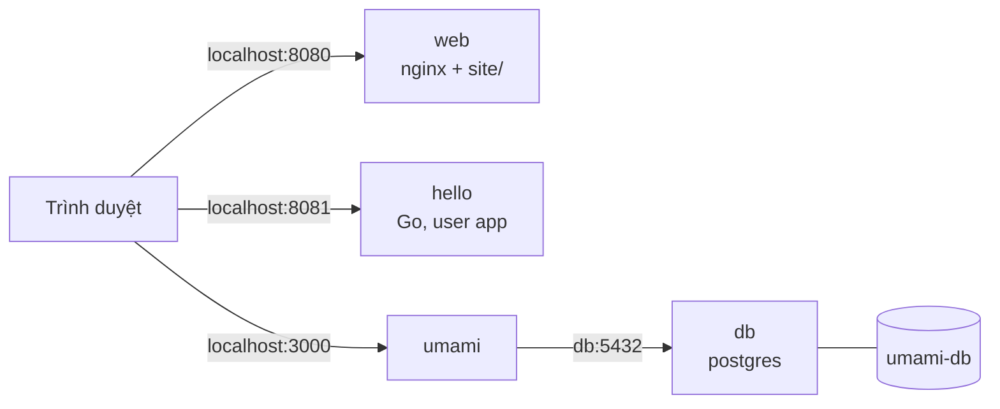

# Hướng dẫn dự án cuối

Bạn đã có đủ mảnh ghép. Dự án cuối ráp chúng lại thành **một repo** mà người khác mở ra là hiểu, clone về là chạy được, và image của bạn nằm sẵn trên registry.

## 1. Chọn ứng dụng

Chọn **một** trong hai hướng:

**Hướng A (khuyên dùng cho người mới): mở rộng stack của bạn.** Lấy repo trang web + Umami + Postgres của chương 6, thêm service thứ tư là ứng dụng `hello-go` của chương 3:

- `hello-go` build từ Dockerfile multi-stage, chạy bằng user `app`;
- trang web có thêm một liên kết tới `hello-go` (ví dụ `http://localhost:8081`);
- image `hello-go` được push lên GHCR với tag semver.

**Hướng B: ứng dụng của bạn.** Một đồ án môn học hay dự án cá nhân có ít nhất một phần cần build (Node, Python, Java, Go…) và một database. Bạn tự viết Dockerfile cho nó. Hỏi mentor trước khi chọn hướng này để chắc phạm vi vừa sức.

Dù chọn hướng nào, bài nộp phải có những thứ dưới đây.

| Yêu cầu | Học ở chương |
| --- | --- |
| Ít nhất **3 service** trong `compose.yaml`, trong đó có một database | 5 |
| Ít nhất một image **tự build** từ Dockerfile của bạn, multi-stage nếu ứng dụng cần build, chạy bằng **user không phải root** | 2, 3 |
| `.dockerignore` có `.git` và `.env` | 3 |
| Database dùng **named volume**, không mở `ports` | 4, 5 |
| Mật khẩu trong `.env` (ngoài Git), có `.env.example` | 6 |
| **Healthcheck** cho mọi service, `depends_on` với `condition: service_healthy` | 6 |
| Mọi image dùng **tag cụ thể** | 2 |
| Image tự build được **push lên GHCR**, tag semver, package public | 7 |
| **README** đủ để người lạ chạy được | 8 |

## 2. Vẽ sơ đồ trước khi viết file

Trước khi gõ `compose.yaml`, vẽ ra giấy: có những service nào, ai gọi ai **bằng tên gì, cổng nào**, cái gì mở ra máy bạn, dữ liệu nằm ở volume nào. Ví dụ với hướng A:



Sơ đồ này nên nằm luôn trong README: người đọc hiểu hệ thống trong 10 giây.

![Bản đồ dự án cuối. Bên trái là cây thư mục repo my-site gồm site, hello-go với Dockerfile multi-stage chạy USER app cùng go.mod và main.go, Dockerfile nginx, .dockerignore, compose.yaml, .env.example được commit, .gitignore có .env, README.md. Mũi tên up dẫn sang network Compose có bốn service: web cổng 8080, hello cổng 8081, umami cổng 3000, db không mở cổng và gắn volume umami-db; mọi service có healthcheck, umami chờ db healthy. Image hello được đẩy lên ghcr.io/ten-ban/hello-go:1.0.0 bằng docker compose push hello.](../../../assets/final-project-map.png)

## 3. Repo hoàn chỉnh trông thế nào (hướng A)

```text
my-site/
├── site/                  # trang web (chương 2)
├── hello-go/              # ứng dụng Go (chương 3)
│   ├── Dockerfile         # multi-stage, USER app
│   ├── .dockerignore
│   ├── go.mod
│   └── main.go
├── Dockerfile             # nginx cho trang web
├── .dockerignore          # .git, .env
├── compose.yaml           # web, hello, umami, db
├── .env.example           # commit
├── .gitignore             # có .env
└── README.md
```

Service `hello` trong `compose.yaml` build từ thư mục con:

```yaml
  hello:
    build: ./hello-go
    image: ghcr.io/ten-ban/hello-go:${HELLO_VERSION:-1.0.0}
    ports:
      - "8081:8080"
    healthcheck:
      test: ["CMD-SHELL", "wget -qO /dev/null http://localhost:8080/ || exit 1"]
      interval: 5s
      timeout: 3s
      retries: 5
```

**Đọc hiểu:**

- `build: ./hello-go`: build context là thư mục `hello-go` (chương 2), Compose tìm `Dockerfile` trong đó.
- Có **cả** `build` và `image`: Compose build rồi **đặt tên** image theo dòng `image`. Sau đó `docker compose push hello` đẩy đúng image đó lên GHCR (đã `docker login` ở chương 7). Thay `ten-ban` bằng tên GitHub của bạn, chữ thường.
- `${HELLO_VERSION:-1.0.0}`: tag lấy từ biến `HELLO_VERSION` trong `.env`, không có thì là `1.0.0` (chương 6). **Phải tăng số trước mỗi lần push bản mới**: nếu giữ nguyên `1.0.0`, lần `up --build` sau sẽ dán nhãn `1.0.0` lên code mới và `compose push` **ghi đè** bản `1.0.0` trên GHCR, đúng điều chương 7 cấm. Sửa code `hello-go` rồi thì đặt `HELLO_VERSION=1.0.1` trong `.env`, `docker compose up -d --build --wait`, rồi `docker compose push hello`.
- Dùng Mac chip Apple? `compose push` chỉ đẩy bản arm64. Để mentor (máy amd64) pull được, push bằng lệnh `docker buildx build --platform linux/amd64,linux/arm64 … --push ./hello-go` của chương 7, bài 2, mục 5.
- `"8081:8080"`: chương trình Go nghe 8080 bên trong; 8080 trên máy đã dành cho `web`, nên mở ra cổng 8081.
- Healthcheck dùng `wget`, có sẵn trong image `alpine` mà stage cuối dùng làm nền.

## 4. README

**README** (*đọc tôi*) là trang đầu tiên người khác (và mentor) đọc. Viết cho một người **chưa từng thấy repo**:

1. **Tên và một câu mô tả** dự án.
2. **Sơ đồ** các service (mục 2).
3. **Cần cài gì**: Docker Desktop (hoặc Docker Engine có Compose).
4. **Chạy trên máy**: từ `git clone` tới mở các trang, có bước tạo `.env` (cả lệnh PowerShell).
5. **Các cổng và tài khoản mặc định**, nhắc đổi mật khẩu admin Umami.
6. **Chạy image từ GHCR**: lệnh `docker pull`, `docker run`.
7. **Gỡ lỗi**: 2–3 lỗi hay gặp và cách sửa (lấy từ chính lỗi bạn đã gặp).

Mẫu mục "Chạy trên máy":

````markdown
## Chạy trên máy

Cần Docker Desktop.

```bash
git clone https://github.com/ten-ban/my-site.git
cd my-site
cp .env.example .env        # PowerShell: Copy-Item .env.example .env
# mở .env, đổi mật khẩu
docker compose up -d --wait
```

- Trang web: http://localhost:8080
- hello-go: http://localhost:8081
- Umami: http://localhost:3000 (lần đầu đăng nhập admin / umami, đổi mật khẩu ngay)

Dừng: `docker compose down`. Xóa cả dữ liệu: `docker compose down -v`.
````

## 5. Tự kiểm tra trước khi nộp

Làm trên một thư mục **mới clone**, không phải thư mục bạn đang làm việc:

```bash
git clone https://github.com/ten-ban/my-site.git kiem-tra
cd kiem-tra
cp .env.example .env
docker compose up -d --wait
docker compose ps
git log --all --oneline -- .env
docker compose down -v
```

**Đọc hiểu:** clone mới bảo đảm repo không phụ thuộc file chỉ có trên máy bạn (quên commit `site/style.css` là lỗi rất hay gặp). `up -d --wait` phải kết thúc thành công, `ps` thấy mọi service `healthy`. `git log … -- .env` phải **không in gì**.

Rồi đi qua danh sách:

- [ ] Mọi image trong `compose.yaml` và `FROM` có tag cụ thể.
- [ ] `docker compose exec hello whoami` in `app` (hoặc user không phải root của bạn).
- [ ] Package trên GHCR là public; `docker logout ghcr.io` rồi `docker pull` vẫn được.
- [ ] Trong image không có `.env` (chương 3).
- [ ] README có đủ 7 mục.

## 6. Rubric

Mentor chấm theo **rubric** (*bảng tiêu chí chấm*) trong bài tập "Dự án cuối". Đọc rubric **trước** khi làm, để biết chỗ nào nặng điểm: chạy được trên bản clone mới và không lộ bí mật là hai tiêu chí nặng nhất.

## 7. Ngoài thực tế

Repo bạn vừa làm có đúng hình dạng của một dịch vụ thật ở công ty: code, Dockerfile, `compose.yaml` cho môi trường dev, `.env.example`, README, image phiên bản trên registry. Khi đi phỏng vấn thực tập, một repo như vậy, có README rõ ràng và chạy được bằng một lệnh, nói về bạn nhiều hơn một dòng "biết Docker" trong CV.

## 8. Khi bị lỗi

| Lỗi | Vì sao | Cách sửa |
| --- | --- | --- |
| Bản clone mới thiếu file, build lỗi `not found` | Quên commit file, hoặc `.gitignore` bỏ nhầm | `git status` ở thư mục gốc; commit file thiếu |
| `hello` mãi `unhealthy` | Healthcheck gọi sai cổng, hoặc image không có `wget` | Gọi cổng 8080 bên trong; stage cuối dùng `alpine` |
| `docker compose push hello` báo `denied` | Chưa `docker login ghcr.io`, hoặc tên image không đúng namespace | Chương 7 |
| Lỗi khác, hoặc chưa hiểu vì sao | | Nhắn mentor, công khai hay **nhắn riêng** đều được (tab **Cài đặt** → "Hỏi ở đâu") |

## Tóm tắt

- Chọn hướng A (mở rộng stack) hoặc hướng B (ứng dụng của bạn); cả hai cần đủ bảng yêu cầu ở mục 1.
- Vẽ sơ đồ trước, đưa sơ đồ vào README.
- Tự kiểm tra trên bản clone mới; `.env` không bao giờ có trong lịch sử Git.
- Đọc rubric trước khi làm.
