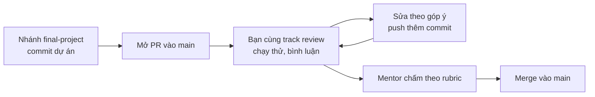

# Nộp qua pull request và review bài của bạn khác

Ở công ty, không ai đưa thay đổi vào nhánh chính mà không có người khác xem. Dự án cuối làm đúng quy trình đó: bạn nộp bằng **pull request**, và bạn **review** bài của một bạn khác.

## 1. Pull request trong 5 dòng

**Pull request** (PR, *yêu cầu gộp thay đổi*) là đề nghị gộp các commit từ một nhánh vào nhánh khác trên GitHub. Nó tạo ra một trang để người khác đọc thay đổi, chạy thử, và bình luận từng dòng. Bạn đã gặp PR ở track Git & GitHub; ở đây chỉ cần ba lệnh:

```bash
git switch -c final-project
git push -u origin final-project
```

**Đọc hiểu:** `git switch -c final-project` tạo và chuyển sang nhánh mới tên `final-project` (`-c` = *create*). Commit các thay đổi của dự án cuối trên nhánh này. `git push -u origin final-project` đẩy nhánh lên GitHub (`-u` nhớ liên kết nhánh, lần sau chỉ cần `git push`). Trên trang repo, GitHub hiện nút **Compare & pull request**: bấm, viết mô tả, tạo PR vào `main` của **chính repo bạn**.



Mô tả PR nên có: làm gì, chạy thử thế nào (trỏ tới README), và bằng chứng (output `docker compose ps` với mọi service `healthy`, link package GHCR).

## 2. Review bài của bạn khác

**Code review** (*xem lại code*) là đọc thay đổi của người khác, **chạy thử**, và góp ý trước khi gộp. Mentor sẽ ghép cặp, hoặc bạn tự tìm một bạn trong kênh Discord của track.

Làm theo thứ tự này, đúng như mentor làm:

1. **Đọc README như người lạ.** Chỉ làm theo những gì README ghi. Chỗ nào phải đoán là chỗ cần góp ý.
2. **Clone và chạy:** `cp .env.example .env`, `docker compose up -d --wait`, `docker compose ps`. Mở các trang.
3. **Đọc `compose.yaml` và Dockerfile** với danh sách:
   - [ ] Có mật khẩu nào nằm thẳng trong file không?
   - [ ] Image có tag cụ thể không?
   - [ ] Database có volume, không có `ports`?
   - [ ] Có healthcheck và `condition: service_healthy`?
   - [ ] Image tự build có `USER` không phải root, có `.dockerignore`?
4. **Kiểm tra lịch sử:** `git log --all --oneline -- .env` không in gì.
5. **Dọn:** `docker compose down -v`.

## 3. Viết nhận xét thế nào

Nhận xét tốt thì **cụ thể, có lý do, và tử tế**. Người nhận phải biết sửa ở đâu, vì sao.

| Chưa tốt | Tốt |
| --- | --- |
| "README khó hiểu." | "Ở mục Chạy trên máy, thiếu bước `cp .env.example .env`; mình chạy `up` thì gặp `env file not found`." |
| "Sai healthcheck." | "Healthcheck của `hello` gọi `localhost:8081`, nhưng bên trong container app nghe 8080, nên service mãi `unhealthy`." |
| "Ổn." | "Chạy được ngay trên bản clone, sơ đồ trong README giúp mình hiểu hệ thống rất nhanh. Một gợi ý: …" |

Luôn có **ít nhất một điểm làm tốt** và **một gợi ý cụ thể**. Góp ý về **bài**, không về **người**. Thấy mật khẩu thật bị lộ trong repo của bạn khác: **nhắn riêng** họ (và mentor), đừng chỉ ra trong bình luận công khai.

## 4. Nhận góp ý

- Trả lời từng bình luận: sửa rồi thì ghi "Đã sửa ở commit …", không đồng ý thì giải thích lý do.
- Sửa bằng commit mới trên cùng nhánh, `git push`: PR tự cập nhật.
- Chưa hiểu góp ý thì hỏi lại. Hỏi lại là bình thường, kể cả hỏi riêng mentor.

## 5. Ngoài thực tế

Ở công ty, mỗi PR thường cần ít nhất một người review đồng ý mới được merge, và hệ thống CI tự chạy kiểm tra trước. Người review giỏi không chỉ tìm lỗi mà còn **chạy thử**, vì "đọc thấy đúng" khác "chạy thấy đúng". Kỹ năng review, viết nhận xét rõ ràng và nhận góp ý không tự ái, quan trọng ngang kỹ năng viết code.

## 6. Khi bị lỗi

| Lỗi | Vì sao | Cách sửa |
| --- | --- | --- |
| Không thấy nút **Compare & pull request** | Chưa push nhánh, hoặc đã quá lâu | Tab **Pull requests** → **New pull request**, chọn nhánh `final-project` |
| PR hiện quá nhiều file lạ | Commit nhầm thư mục `node_modules/` hay file tạm | Thêm vào `.gitignore`, `git rm -r --cached <thư-mục>`, commit |
| Bài của bạn được review chạy không được, máy bạn thì chạy | Thiếu file trong Git, hoặc phụ thuộc thứ chỉ có trên máy bạn | Tự kiểm tra trên bản clone mới (bài trước, mục 5) |
| Lỗi khác, hoặc chưa hiểu vì sao | | Nhắn mentor, công khai hay **nhắn riêng** đều được (tab **Cài đặt** → "Hỏi ở đâu") |

## Tóm tắt

- Nộp dự án bằng PR từ nhánh `final-project` vào `main` của repo bạn.
- Review: đọc README như người lạ, clone và chạy, đi qua danh sách, dọn dẹp.
- Nhận xét cụ thể, có lý do, có điểm tốt; bí mật bị lộ thì báo riêng.
